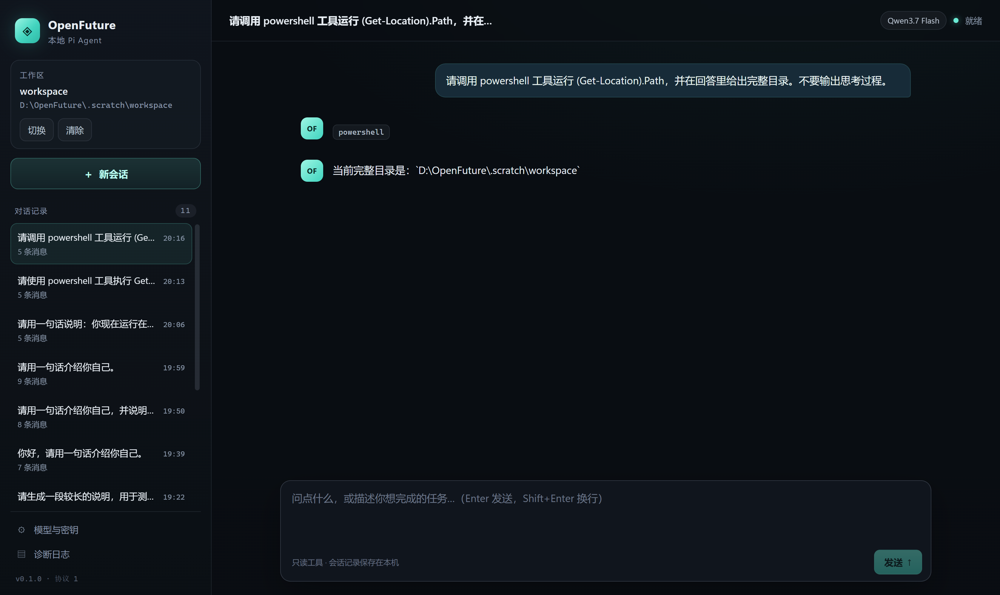
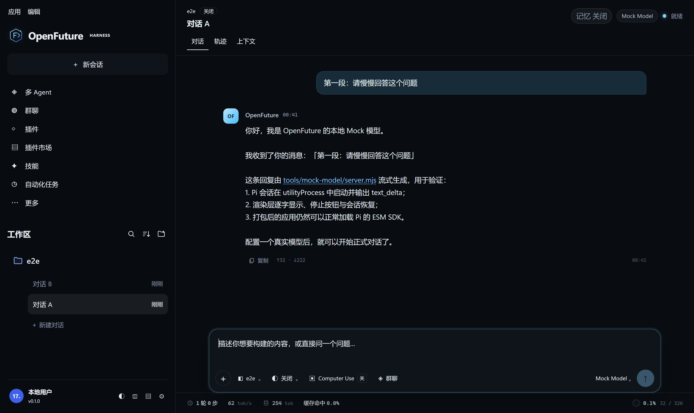

# OpenFuture

GitHub: https://github.com/Dushiqi1987/OpenFuture

本地优先的 Windows 桌面 Agent，基于 [Pi](https://github.com/earendil-works/pi) SDK（`@earendil-works/pi-coding-agent@1.5.0`）二次开发。

当前进度：**P0–P3、P3.1–P3.4、v0.2 A 与 B0 完成；DSH 风格常显思考链、会话状态栏与回答尾部操作完成**。P0 桌面底座（流式对话、停止、恢复、FTS5、PowerShell 授权）、P0.1 安全修复（工具边界、凭证绑定）、P1 记忆层（L0–L2、RAG/Wiki/组合、引用）、P2 Dreaming（裁决/发布/回滚/撤销、L3 注入）、P3 质量门/预算/空闲调度、P3.1 撤销过滤/正则 Worker/历史清理、P3.2 会话取证与错笔记纠正、P3.3 可选 QMD 词法检索与 pi-llm-wiki MCP 检索、P3.4 OF-01～OF-05 安全整改（证据依赖、陈旧候选、工具结果按条目过滤、Wiki 工作区隔离与详情）均已实现并留有验证记录。v0.2 A 增加 Codex 风格项目树/多项目对话/草稿/主题/旧数据迁移，并提供独立候选。默认仍使用 SQLite FTS5；QMD/Wiki 通过外部可选路径启用，失败自动回退 FTS5。



## 功能

- **工作区与会话**：选择本地工作区；会话列表、恢复历史会话；新会话。
- **流式对话**：文本增量渲染，推理模型（如 qwen3.7-flash）的思考/工具调用以 DSH 风格常显链展示，一个回合一个头像。
- **停止**：中断当前流式输出，保留已生成内容并落盘。
- **模型配置**：任意 OpenAI Chat Completions 兼容服务；Base URL、模型 ID、上下文窗口、最大输出 token、推理开关。
- **密钥安全**：API Key 使用 Windows DPAPI（Electron `safeStorage`）加密保存；Pi 通过环境变量注入密钥，`models.json` 只写 `$OPENFUTURE_MODEL_API_KEY` 占位符，不落盘明文。
- **独立记忆进程**：`memory-host` utilityProcess 独占 SQLite；WAL + FTS5（trigram）自检，支持中文三字以上查询。
- **诊断面板**：查看主进程/Agent/Memory 进程日志。
- **PowerShell 显式授权**：默认关闭；在「模型与密钥」中手动开启后，Agent 工具列表才会加入 `powershell`。
- **免费网络搜索**：内置 `web_search`，使用 Exa 公共 MCP，并在失败时回退 AnySearch 匿名接口，无需 API Key；会向模型提供当前日期、发布时间和 `freshness`（day/week/month/year/any），默认优先最近一个月。系统提示只注入当天日期（同一天内稳定，避免每分钟改写前缀导致缓存失效），精确时间通过 `current_time` 工具获取。详细说明见 `docs/Free-Web-Search-接入-验收记录.md` 和 `docs/时间与缓存-验收记录.md`。
- **中途引导与排队**：运行中仍可输入；Enter 排队到本轮结束，Ctrl/Cmd+Enter 或“引导”按钮在当前工具调用结束后、下一次模型请求前投递；停止会取消未投递消息并退回输入框。详细说明见 `docs/中途插话-验收记录.md`。
- **自动化任务**：绑定项目的一次/间隔/每日/每周任务；应用内定时触发，在项目下新建独立对话运行并保留记录。支持暂停/恢复、立即运行、编辑、删除。模型也可以通过 `automation_create/list/set_active/cancel` 工具在当前项目里直接创建和管理任务，例如“一分钟后帮我搜索……”。详细说明见 `docs/自动化任务-验收记录.md`。

## 快速开始

### 环境

- Windows 11 x64
- Node.js >= 22.19（本项目使用 Node 24.21 验证）
- pnpm 11

> 本机系统 PATH 上的 `node` 是 v14，不能用于本项目。请把 Node 24 放到 PATH 最前，或使用完整路径调用。示例：
>
> ```bash
> export PATH="/c/Users/杜世旗/.dsh/dsh-runtimes/dsh-primary-runtime/dependencies/node/bin:$PATH"
> NODE="/c/Users/杜世旗/.dsh/dsh-runtimes/dsh-primary-runtime/dependencies/node/bin/node.exe"
> PNPM="/c/Users/杜世旗/.dsh/dsh-runtimes/dsh-primary-runtime/dependencies/pnpm/bin/pnpm.mjs"
> "$NODE" "$PNPM" install
> ```

### 安装依赖

```bash
pnpm install
# pnpm 11 可能因 ignored build scripts 返回非零；Electron 二进制需要手动安装：
node node_modules/electron/install.js
```

依赖与 Electron 二进制镜像已配置在 `.npmrc`（npmmirror）。

### 开发运行

```bash
# 必须清除这两个环境变量：
# - ELECTRON_RUN_AS_NODE：继承后 Electron 会以纯 Node 模式启动，没有 app 对象
# - PWD：MSYS 风格的 PWD（如 /d/OpenFuture）会让 Chromium 启动即崩
unset ELECTRON_RUN_AS_NODE PWD

pnpm dev
```

### 使用 Mock 模型（离线验证 UI）

```bash
pnpm mock-model
# 模型设置：Base URL = http://127.0.0.1:8787/v1，模型 ID = mock-model
# 上下文窗口 128000，最大输出 8192
```

Mock 服务实现了 `GET /v1/models`、`POST /v1/chat/completions`（SSE 流式），会回显最后一条用户消息，用于验证流式、停止、恢复。

### 可选检索引擎（QMD / pi-llm-wiki）

默认使用内置 FTS5，不需要额外依赖。若要启用外部引擎，启动前设置环境变量：

```bash
# QMD：索引当前工作区 active evidence，失败自动回退 FTS5
export OPENFUTURE_QMD_MODULE="D:/path/to/qmd/node_modules/@tobilu/qmd/dist/index.js"

# pi-llm-wiki：通过 stdio MCP 调用 wiki_recall，失败只影响 Wiki 命中
export OPENFUTURE_WIKI_MCP="D:/path/to/pi-llm-wiki/dist/mcp/index.js"
export OPENFUTURE_WIKI_ROOT="D:/path/to/wiki/vault"
```

- QMD 索引位于用户数据目录 `memory/qmd/<workspaceId>/`，撤销 source 后对应 evidence 会从语料和结果中消失。
- Wiki 命中只读展示 recall 的 preview，不写入本地 Wiki 草稿；模式为 `wiki` 或 `both` 时才查询。
- 两个引擎都是可选外部资源，界面搜索提示会显示实际引擎与回退原因。
- 设置 `OPENFUTURE_QMD_HYBRID=1` 可尝试 QMD 向量与关键词混合检索。该路径需要 QMD 模型权重，失败时使用关键词检索，超时时使用 FTS5。
- 设置 `OPENFUTURE_DOCLING_PYTHON` 为已安装 Docling 的 Python 可执行文件绝对路径，可启用 PDF OCR。解析失败时使用内置 PDF 文本解析器。
- 上下文压缩默认启用 `billion-context-pi@0.1.83`：在 `插件 → 上下文压缩` 或设置中切换。启用后 agent-host 加载 ACP 扩展，提供 `compress / decompress / search_context / acp_status / acp_cache`，压缩块与 sidecar 写入用户数据目录和 `acp.log`；关闭后使用 Pi 原生压缩。

### 设置

设置对话框已改为左侧分组 + 右侧内容，共五组（入口：右上角齿轮、`应用 → 模型与密钥` 或顶部的 API Key 提示条）：

| 分组 | 可调项 | 生效方式 |
| --- | --- | --- |
| 外观 | 主题（跟随系统/深色/浅色）、界面缩放（90%–125%）、消息密度（舒适/紧凑）、时间戳开关 | 立即生效，写入 `settings.json` 的 `ui` 块；缩放由主进程在每次 `did-finish-load` 重新应用 |
| 模型与密钥 | Base URL、模型 ID、显示名、上下文窗口、最大输出、推理开关、API Key | 保存后重启 agent-host；API Key 与端点绑定并走 safeStorage |
| 对话与输入 | 发送快捷键（Enter / Ctrl+Enter）、思考等级（off/low/medium/high）、上下文压缩 | 快捷键与压缩立即生效；思考等级会停止 agent-host，下一个会话按新等级创建 |
| 工具与权限 | Computer Use、PowerShell（高风险）、并行子 Agent + 并发数、群聊 Agent | 保存后重启 agent-host（Computer Use 也可在 composer 随手开关） |
| 关于 | 应用版本、协议版本、数据目录、密钥状态、清除密钥 | 只读信息 / 清除密钥需重启 |

说明：

- 主题按钮（右上角月亮/太阳图标）与设置里的主题双向同步：点按钮会立即调用 `setUiPreferences({ theme })`，重启后保持。
- `settings.json` 的 `ui` 块被逐项校验；旧配置缺失时回退 `system / 1 / comfortable / 时间戳开 / Enter 发送 / medium`。
- 「思考等级」通过 `OPENFUTURE_THINKING_LEVEL` 传给 agent-host，`createAgentSession({ thinkingLevel })` 只在新会话创建时读取。
- 外观类设置不会强制你先配置模型：没有模型时也能保存主题与密度。

验证（需要先 `pnpm build`）：

```bash
node tools/settings-smoke.mjs            # 外观保存 + 数据集 + 持久化
THINKING=1 node tools/settings-smoke.mjs # 额外验证思考等级会停止 agent-host
EMPTY=1 node tools/settings-smoke.mjs    # 空配置下只改外观也能保存
```

### Computer Use（Windows 桌面）

Computer Use 默认关闭。打开 `插件 → Computer Use`，或 composer 的 Computer Use 开关，应用会按需启动本地 `windows-mcp` MCP 服务；关闭开关会使 agent-host 重启并移除全部桌面工具。

前置条件：

```powershell
irm https://astral.sh/uv/install.ps1 | iex
uvx windows-mcp@0.8.8 --help
```

说明：

- OpenFuture 只申请 15 个白名单工具（截图、快照、点击、输入、滚动、移动、快捷键、剪贴板、等待、通知等），不申请 PowerShell、文件系统、注册表、启动应用、网页抓取或进程管理工具。
- 桌面工具会直接操作用户当前桌面，属于高权限能力；请只在你信任的任务中临时打开。
- Windows-MCP 有用户输入门控：点击、移动、输入等动作要求桌面空闲约 10 秒；OpenFuture 会自动等待并重试，`USER_CONTROL` 只表示用户刚操作过，不是故障。截图、快照和状态查询不受此限制。
- 已真机验证截图与鼠标移动；点击、输入等动作尚未逐项验证。首次启动需要 uv 准备 Python 依赖，可能耗时数十秒。
- 启动策略：应用启动时若已开启 Computer Use，会在后台预热 `windows-mcp`；打开会话最多等它 10 秒，超时就先不带桌面工具，等下一次打开会话时再带上。初始化 45 秒未完成视为失败，之后 60 秒内快速失败（不阻塞会话），失败只写日志，不再弹「调用超时」横幅。重启应用可立即重试。
- 可用 `OPENFUTURE_UVX` 指定 `uvx.exe` 的绝对路径；默认查找 `%USERPROFILE%\.local\bin\uvx.exe`。

### 自动化任务

打开 `自动化任务`，新建任务并选择项目、指令和重复方式：

- 一次：指定日期时间；
- 间隔：每 N 分钟（1–10080）；
- 每日：每天固定 `HH:mm`；
- 每周：每周固定星期与 `HH:mm`。

到点后 OpenFuture 默认在任务绑定的项目下新建对话，使用当前模型配置执行指令，并写入运行记录。运行记录中的「打开对话」可直接跳转到执行对话。新建/编辑表单可选择「当前对话」或「新建对话」。模型通过 `automation_create` 创建任务时默认绑定当前对话，到点继续在原对话里执行，结果会出现在该对话中；如需独立对话可传 `target: 'new'`。任务串行执行；暂停后不再触发；删除会同时删除运行记录。

限制：

- 应用关闭时不后台联网；重开后只补跑最近一次错过的任务。
- 暂不支持 cron/rrule、失败重试通知和运行中取消。
- 自动化对话不会自动切换到前台；运行记录提供「打开对话」入口。
- 首次测试使用隔离 profile 和本地 mock；真实模型长任务尚未逐项验证。

详细说明与证据见 `docs/自动化任务-验收记录.md`。

### 多 Agent 会话

侧栏的「多 Agent」可把普通会话变成具名角色 Agent：

- 新建 Agent：填写角色名（如“赋能财经智能体”）、角色提示词（如“我是一个财经助理……”）和所属项目；
- 打开后，聊天 header 显示角色 badge，composer 提示“以 XX 身份输入…”；
- 角色通过 system prompt 注入，记忆关闭时也生效；会话仍沿用现有消息、工具、流式、草稿和模型配置；
- 支持编辑角色、删除 Agent（只删项目注册表，不删 Pi JSONL）；
- 普通项目和普通对话不受影响。

角色提示对历史会话同样生效，但修复前创建的旧会话可能仍受历史中的编码助手身份影响；建议为角色新建会话。

详细说明见 `docs/多Agent会话-验收记录.md`。

### 并行子 Agent

主 Agent 可以在一次回复中派发 1–4 个自包含子任务，由最多 3 路子 Agent 并行执行，结果汇总后回到主对话：

- **工具**：`delegate_tasks`，参数 `tasks: [{ title, prompt }]` 加可选 `timeoutSeconds`（30–600，默认 180）；
- **隔离**：每个子 Agent 是独立的 Pi 会话，有独立上下文与独立取消，写入 `<sessionDir>/subagents/*.jsonl`，头部 `parentSession` 指向父会话文件；
- **工具集**：继承工作区只读工具（read/grep/find/ls）与 web/时间工具，剥离 `computer_*`、`automation_*`，且不暴露 `delegate_tasks` 本身（结构性防递归）；
- **进度**：输入框上方显示「并行子 Agent」进度条（等待/执行/调用工具/完成/失败/超时），按 `taskId` 更新；
- **取消**：`stop` 会级联取消全部子 Agent。

配置：设置对话框「工具与权限」里的「启用并行子 Agent（delegate_tasks）」与「子 Agent 并发数」（1–4，默认 3），保存后 Agent 进程自动重启；子 Agent 以当前会话的角色身份作答。设置项经 `hostEnvironment()` 传给 agent-host，会覆盖启动环境里的同名变量（`OPENFUTURE_SUBAGENTS`、`OPENFUTURE_SUBAGENT_CONCURRENCY` 仅在直接调 `SubagentRuntime` 或冒烟脚本时使用）。

局限：子 Agent 共享同一工作区，没有 worktree 隔离，不要让多个子任务并发写同一批文件；单个子任务结果上限 12K 字符。

离线验证（自动启动 mock 模型，断言 3 路并行与父子会话链接）：

```bash
node tools/subagent-smoke.mjs   # runtime 层：并发、事件、父子会话
pnpm build && node tools/e2e-subagent.mjs   # 桌面端到端：进度条渲染 + 汇总回答
```

验收记录见 `docs/并行子Agent-验收记录.md`；调研、方案对比与后续路线见 `docs/多Agent实现方案调研与适配-2026-11.md`。

### 群聊 Agent（串行讨论）

主 Agent 可以把一个任务交给「主研 + 评审 + 主持」组成的群聊，按轮次串行讨论，最后由主持输出双方认可的方案或分歧清单：

- **入口**：左侧栏「群聊」打开群聊面板——历史讨论列表 + 讨论记录 + 成员模型配置；输入框左侧工具栏的「群聊」按钮 → 填目标与轮数 → 直接开一场讨论，不需要模型自己想起调用工具；也可以由主 Agent 在对话中自行调用；
- **工具**：`start_group_chat`，参数 `goal`，可选 `constraints`、`focus`（评审关注点）、`rounds`（1–3，默认 2）；
- **角色与权限**：主研拿完整只读工具集；评审只能用 `read/grep/find/ls/web_search/current_time`；主持不调用工具、只做综合。三者的角色卡通过 Pi 的 `before_agent_start` 注入系统提示，而不是每个角色各写一套代码；
- **提示词拼接**：每轮只给该角色注入「未读消息」（按 `seq` 增量），不重复整段历史；主持拿压缩后的全量转写。上下文三层上限：单条发言 4000 字符、每轮注入 8000 字符、主持转写 12000 字符；
- **收敛**：评审必须输出「立场：同意|存疑|反对」与「阻断项：有|无」，双方都同意且无阻断才算收敛；最多 3 轮，未收敛时主持输出【未收敛】+ 分歧清单；连续两轮无工具调用且发言相似度 > 0.9 判为停滞；
- **工具冲突**：同一时刻只有一个角色在跑（串行），工具证据按 `E1/E2` 编号写进转写，评审只读，写操作仍由主对话负责；
- **面板**：输入框上方显示群聊记录（角色 / 阶段 / 工具次数），每条发言完整展示、超长时在卡片内滚动；运行中显示当前阶段与已等待时间；结束时状态为「已达成共识 / 未收敛 / 停滞」；
- **会话**：每个角色一个 Pi 会话，写入 `<sessionDir>/group/*.jsonl`，`parentSession` 指向父会话；群聊结束即释放，下一次从干净上下文开始；
- **成员模型**：面板「成员与模型」可以给主研/评审/主持分别绑定一个「额外模型」（显示名称、接口地址、模型 ID、API Key，例如主研用千问、评审用 DeepSeek、主持用 GLM），未绑定的角色用主模型；密钥用 safeStorage 加密保存在本机，新增/修改额外模型会重启 Agent 进程以重新加载 provider 列表，角色绑定不需要重启；
- **历史记录**：每场群聊由主进程折叠 `group` 事件落盘到 `<userData>/config/group-chats/<chatId>.json`，面板里可以回看任意一场的完整发言与成员配置。

配置：设置对话框「工具与权限」里的「启用群聊 Agent（start_group_chat）」，保存后 Agent 进程自动重启。

```bash
node tools/group-chat-smoke.mjs   # runtime 层：共识 / 未收敛两条路径 + 父子会话
pnpm build && node tools/e2e-group-chat.mjs   # 桌面端到端：面板渲染 + 结论回填
E2E_GROUP_MANUAL=1 node tools/e2e-group-chat.mjs   # 桌面端到端：工具栏「群聊」按钮入口
pnpm build && node tools/e2e-group-panel.mjs   # 桌面端到端：侧边栏面板 + 额外模型档案 + 评审换模型
```

验收记录见 `docs/群聊Agent-验收记录.md`；调研与设计取舍见 `docs/群聊Agent调研与适配-2026-11.md`。

### DSH 插件市场与自动适配

左侧栏「插件市场」把 DeepSeek Harness 的插件目录接进 OpenFuture。DSH 插件基于 cordis，接口与本项目的 Pi 扩展不兼容，所以下载后需要一次「模型改写」：

- **目录**：优先用 npm 镜像包 `dsh-plugin-catalog`（gzip 后约 5 MB）还原官方目录，失败再回退到官方 `https://awesome-dsh-plugin.com/plugins.json`；TTL 6 小时并落盘缓存，**有缓存时面板立即打开**、过期后后台静默刷新（首次拉取约 20 秒，面板会显示提示）。可用 `OPENFUTURE_MARKET_CATALOG` 指向本地 JSON 文件（绝对路径或 `file://`）或镜像、`OPENFUTURE_NPM_REGISTRY` 指向 npm 镜像；刷新失败时面板仍会列出已下载/已适配的插件，并显示失败原因；
- **下载**：目录按发布者和名称区分插件，并提供分类、排序、搜索和分页。支持 Release `tarball` 和 npm 包，缺少安装包的条目显示「暂无可用安装包」。压缩包上限为 40 MB，解包后存到 `<userData>/plugins/dsh/<id>/`。
- **适配**：优先将 `package.json`、入口和源码发给当前模型，总预算约 4 万字符。产物通过语法和默认导出检查后，写入 `<userData>/plugins/adapted/<id>/plugin.js`，并把说明写进 `manifest.json`。界面显示适配进度和失败原因。
- **启用**：新产物默认停用。在商城查看代码、安装所需依赖并手动启用后，Agent 会在空闲时重载。回到原对话继续发送即可加载新工具集。插件加载失败时，商城和「已适配插件」面板会显示错误。
- **使用**：已启用的插件可通过 `dsh_*` 注册工具，通过 `before_agent_start` 注入提示，或通过 `registerCommand` 添加输入框中的斜杠命令。
- **依赖**：模型可以在产物开头声明 `// deps: 包名@版本范围`（最多 6 个公开 npm 包）。面板会显示「安装依赖（N）」，由自实现的安装器从 npm registry 扁平装到 `<userData>/plugins/adapted/<id>/node_modules`（可用 `OPENFUTURE_NPM_REGISTRY` 指向镜像）；不跑 `postinstall`、不编译原生模块，依赖未装齐时宿主跳过该插件。

适配器校验 ESM 语法和默认导出的扩展函数，并根据导入语句识别依赖。契约允许 `api.on(...)`、`api.registerCommand(...)` 和 `api.registerTool(...)`，工具名统一使用 `dsh_` 前缀。依赖 Cordis 服务或 UI 的插件会尝试降级为命令或提示注入，适配说明会列出损失的交互。

```bash
node tools/plugin-market-smoke.mjs   # 离线：fixture 目录 → 安装 → 读源码 → mock 适配 → 产物清单
node tools/plugin-deps-smoke.mjs     # 离线：依赖解析 / 传递依赖 / ESM 导入
pnpm build && node tools/e2e-plugin-market.mjs            # 桌面端到端：下载 → 适配 → 审阅启用 → 原对话继续发送
E2E_PLUGIN_DEPS=1 node tools/e2e-plugin-market.mjs        # 再加一步：安装依赖后加载
```

启用后的代码及其依赖拥有 agent-host 进程的权限。可在面板里查看生成代码、停用或删除。调研记录见 `docs/插件市场与DSH插件适配-2026-11.md`。

### 模型提问与确认（`ask_user`）

模型可以在开工前停下来问清楚需求，或在不可逆操作前请求确认：

- 工具 `ask_user(question, options[2-6], allowCustom?, kind: choice|confirm)`；
- 对话区上方出现卡片：问题 + 选项按钮（可带说明）+ 自定义回答 + 取消；
- 作答后作为工具结果返回模型，回合继续；点「停止」会取消挂起提问；
- 一次只允许一个未回答提问，子 Agent / 群聊角色不能提问；
- 验证：`pnpm build && node tools/e2e-ask.mjs`，细节见 [docs/模型提问与确认-验收记录.md](docs/模型提问与确认-验收记录.md)。

### 文件链接与内置浏览器

Agent 回复里的本地路径（例如刚生成的 `D:\...\page.html`）和 `http(s)` 链接会自动变成可点击的蓝色/绿色文字：

- 点 HTML/SVG 或网址 → 右侧打开内置浏览器（前进/后退/刷新/地址栏/关闭），对话区域自动让出宽度；
- 内置浏览器右上角「外部浏览器」→ 用系统默认浏览器打开；
- 其它类型文件 → 交给系统默认程序；
- 路径按当前工作区解析，文件不存在时给出错误提示。

验证：`pnpm build && node tools/e2e-file-link.mjs`；实现与业界做法对照见 [docs/文件链接与内置浏览器-验收记录.md](docs/文件链接与内置浏览器-验收记录.md)。

### MCP 服务与技能（Skills）

设置对话框新增两个分组，配置都保存在本机，保存后 Agent 会在空闲时重载：

- **MCP 服务**：支持 `stdio`（本地命令 + 参数）和 `url`（HTTP）两种传输，可启用/停用、删除，配置路径显示在面板顶部。配置写入 `<userData>/pi/agent/mcp.json`，由 Pi 内置 MCP 扩展读取；工具统一暴露为 `mcp__<服务>__<工具>`，`exposure: "direct"` 才会直接声明给模型，其余走 codemode / `tool_search`。
- **技能**：左侧栏「技能」面板支持搜索、启用/停用、查看全文、新建，以及从内置「技能库」一键安装模板。每个技能是 `<userData>/skills/<名字>/SKILL.md`，带 `name`、`description` 和可选 `disable-model-invocation`；停用的技能会移到 `skills-disabled`，不再进入系统提示。启用后 Pi 把名称与描述放进系统提示，模型按需读取正文；勾选「仅显式调用」的技能只能用输入框里的 `/skill:<名字>` 触发。

MCP 连接在会话启动时建立，只影响新会话；MCP 工具不会下发给子 Agent 和群聊角色。环境变量 `OPENFUTURE_MCP=0` 可整体关闭 MCP。

```bash
node tools/mcp-smoke.mjs          # 桌面端到端：stdio MCP 服务 + 技能 → 模型实际收到 mcp__demo__echo
node tools/skills-panel-smoke.mjs # 技能面板：搜索 / 技能库安装 / 启停 / 详情
```

验收记录（含参考的开源项目与借鉴点）见 `docs/MCP与技能-验收记录.md`。MCP 服务与技能都由第三方提供内容，启用前请确认来源可信。

### 并发对话（同时跑多个对话）

多个对话可以同时生成：在 A 对话回答到一半时切到 B 发起新任务，A 会继续在后台跑，侧边栏对话标题前出现一个跳动的圆点；切回 A 时自动回放它已经完成的内容，不打断也不重启。

- 每个对话一个独立的 agent-host 进程（utilityProcess），崩溃与工具状态互不影响；
- 默认最多同时运行 3 个对话，可用环境变量 `OPENFUTURE_MAX_CONVERSATIONS` 调整（最小 2）；达到上限时先关闭空闲对话，全部在生成中则提示先停止一个；
- 切回仍在运行的对话走 `history` 回放，不会重新开会话；
- 切换项目/工作区、修改记忆模式或模型设置仍会重建全部对话（属于环境级变更）。

验证：`pnpm build && node tools/e2e-multi.mjs`；细节见 [docs/并发对话-验收记录.md](docs/并发对话-验收记录.md)。



桌面记忆库的「Wiki」页可生成当前项目的多来源主题草稿，展开查看正文和差异，再审核发布。旧版发布页在新草稿审核期间仍可检索。

「协作运行」页可读取已落盘的多 Agent 运行摘要。为同一个项目启动 `parallel/multiagent/scripts/desktop-bridge.ts`，使用端口 19744，通过 `--project-id` 指定运行快照中的项目 ID。桌面启动环境中的 `OPENFUTURE_TEAM_BRIDGE_PROJECT_ID` 必须与桌面项目 ID 一致，`OPENFUTURE_TEAM_BRIDGE_TOKEN` 与桥的 `DESKTOP_BRIDGE_TOKEN` 一致。

### 打包

```bash
pnpm package
```

产物：

- `release/win-unpacked/OpenFuture.exe`：P0 基线免安装目录（保留）
- `release/p0.1-runnable/OpenFuture.exe`：P0.1 安全修复候选
- `release/p1-runnable/OpenFuture.exe`：P1 记忆层候选
- `release/p2-runnable/OpenFuture.exe`：P2 Dreaming 候选
- `release/p3-runnable/OpenFuture.exe`：P3 调度质量候选
- `release/p3.1-security-runnable/OpenFuture.exe`：P3.1 安全整改候选（撤销 L3 过滤、grep 正则 Worker、历史工具结果清理）
- `release/p3.2-evidence-runnable/OpenFuture.exe`：P3.2 取证与纠正候选（会话导入证据、fix 候选、撤销证据拒绝、纠正后刷新 L3；新会话 system 注入已用 mock 复验）
- `release/p3.3-qmd-wiki-runnable/OpenFuture.exe`：P3.3 可选检索引擎候选（QMD + pi-llm-wiki MCP、引擎标识、FTS5 回退）
- `release/p3.4-security-runnable/OpenFuture.exe`：P3.4 安全整改候选（OF-01～OF-05：证据依赖撤销过滤、陈旧纠正候选、记忆工具结果条目级过滤、Wiki 工作区隔离与详情读取）
- `release/v0.2-a-projects-runnable/OpenFuture.exe`：v0.2 A 项目化外壳候选（最新；三栏项目树、多项目对话、草稿、主题、旧数据迁移；浅蓝强调色）
- `release/OpenFuture-0.1.0-x64-setup.exe`：P0 时期的 NSIS 安装包（131 MB，未随 P1–P3 重打）

启动打包版同样需要清理环境变量：

```bash
unset ELECTRON_RUN_AS_NODE PWD
./release/v0.2-a-projects-runnable/OpenFuture.exe
```

## 目录结构

```text
src/
  main/            Electron 主进程：窗口、单实例、IPC 校验、safeStorage、进程管理
  preload/         contextBridge，只暴露类型化 IPC 方法
  agent-host/      utilityProcess：唯一加载 Pi SDK 的地方，会话与事件映射
  memory-host/     utilityProcess：唯一访问 SQLite 的地方
  shared/          IPC 协议、DTO、错误码（主进程/预加载/渲染层共享）
  renderer/        React UI（只接收 DTO，不接触文件路径/密钥/Pi 类型）
tools/             CDP 调试与验收脚本、Mock 模型服务
third_party/pi/    Pi v1.5.0 源码（固定 tag，只读参考）
```

## 架构要点

- **进程边界**：渲染层 → preload → 主进程 → `utilityProcess`（agent-host / memory-host）。Pi SDK 只在 agent-host 中动态 `import()`，主进程和 preload 不加载 Pi。
- **会话**：`SessionManager` 使用用户数据目录下的 `pi/agent/sessions`；agent-host 负责 `open/send/stop/close`，主进程只转发事件。
- **工具**：默认只读 `read/grep/find/ls`；`powershell` 需要显式开关，由主进程通过 `OPENFUTURE_ALLOW_POWERSHELL=1` 注入 agent-host。
- **模型**：主进程把模型配置写成 `models.json`，provider 固定 `openfuture`，`api: openai-completions`，密钥用 `$OPENFUTURE_MODEL_API_KEY` 环境插值。
- **兼容性**：DashScope 不接受 `developer` role，`models.json` 固定 `compat.supportsDeveloperRole: false`。

## 当前模型配置

当前验证模型为阿里百炼 `qwen3.7-flash`：

| 配置项 | 值 |
| --- | --- |
| Base URL | `https://dashscope.aliyuncs.com/compatible-mode/v1` |
| 模型 ID | `qwen3.7-flash` |
| 上下文窗口 | 131072 |
| 最大输出 token | 65536 |
| 推理/思考 | 开启 |

> qwen3.7-flash 默认 `thinking_budget` 为 32768，DashScope 要求 `max_completion_tokens` 大于该值，因此最大输出设为 65536。其他模型可按实际上限调整。

## P0 验收结果

2026-11-08 在 **打包后的 `release/win-unpacked/OpenFuture.exe`** 中完成：

| 验收项 | 结果 | 证据 |
| --- | --- | --- |
| ESM SDK 导入 | 通过 | agent-host 启动，真实 qwen 对话返回 |
| utilityProcess 通信 | 通过 | 会话/流式事件经主进程转发到 UI |
| SQLite FTS5 | 通过 | SQLite 3.53.4，trigram，中文「记忆库」命中 1 条 |
| Pi 事件流 | 通过 | text_delta / thinking_delta 实时渲染 |
| 取消 | 通过 | `tools/cdp-stop-test.mjs` 点击停止，状态收敛、无残留 stop 按钮 |
| 会话恢复 | 通过 | 停止后点击会话项，恢复 user + 部分 assistant 消息 |
| Windows PowerShell 工具 | 通过 | 开启授权后 `(Get-Location).Path` 返回工作区路径 |
| NSIS 安装包 | 通过 | `release/OpenFuture-0.1.0-x64-setup.exe` |

复验脚本（需要应用以 `--remote-debugging-port=9222` 或 `9223` 启动）：

```bash
CDP_PORT=9223 node tools/cdp-chat.mjs "请用一句话介绍你自己。"
CDP_PORT=9223 node tools/cdp-stop-test.mjs
CDP_PORT=9223 node tools/cdp-eval.mjs "window.openfuture.memoryDiagnostics().then(r => JSON.stringify(r))"
```

## 已知限制

- **未签名**：安装包没有代码签名，Windows SmartScreen 会提示。
- **asar 关闭**：为兼容 Pi 的 ESM、原生 `.node` 与 wasm 依赖，当前 `asar: false`，目录约 440 MB。后续可改为 asar + `asarUnpack`。
- **写工具审批未实现**：Agent 默认仅只读工具（read/grep/find/ls + 记忆只读工具）；PowerShell 是粗粒度开关，开启后没有逐命令预览/批准。
- **Dreaming 为确定性 planner**：不调用 LLM，phase 固定 promote；质量门是结构性指标，没有 embedding 漂移、语义评审或纠错率 ≥ 70%。自动调度只生成待审任务，不自动发布。
- **引用不持久化**：citations 仅实时显示，重开会话不恢复；thinking 块可恢复。
- **无自动更新**、无崩溃上报、无多窗口。
- **子 Agent 无 worktree 隔离**：`delegate_tasks` 的子会话共享主工作区，并行写同一批文件会互相覆盖；目前靠工具描述约束，写任务建议串行或后续加 worktree 选项。
- **插件适配不是沙箱**：DSH 插件被模型改写后以 Pi 扩展形式在 agent-host 进程内执行，契约里的「禁网络/禁写盘」只是提示词约束；声明的 npm 依赖也只做扁平安装（不支持多版本共存、不编译原生模块）。官方目录约 14.6 MB，本机网络会在 ~7.7 MB 处断流，真实使用时目录刷新可能失败（可用 `OPENFUTURE_MARKET_CATALOG` 指向镜像或本地文件）。
- **群聊成本与"被带偏"**：群聊串行跑完 2 轮约 4–6 次完整推理（Anthropic 报告多 Agent 约 15× token）；同模型扮演主研/评审容易客套或互相附和，目前靠强制证据、非对称权限（评审只读）、显式立场与未收敛输出约束，仍建议对高价值任务换更强模型或人工复核。
- **并发对话**：后台对话完成后侧边栏不自动重排/刷新标题，只有运行中的圆点；每个并发对话各占一个 utilityProcess，3 个对话约多 3 份 Pi 运行时内存；切换项目或修改模型设置会关闭全部对话。
- 开发模式没有注入 CSP；生产构建已由 Vite 插件注入 `script-src 'self'` 的 CSP。
- 诊断日志不重放启动期日志，只显示订阅之后的内容。

## 与设计文档的偏离

设计文档位于 `F:\VibelutionRuntimes\Windows桌面版Pi-Agent开发设计方案.md`。P0 实现有以下记录在案的偏离：

1. **打包器**：使用 electron-builder + NSIS，而非文档建议的 Electron Forge Squirrel.Windows。文档标注 Squirrel「可用」而非强制；NSIS 在中文 Windows 上更稳定，支持安装目录选择。
2. **仓库形态**：单包应用（根目录即 Electron app），而非 pnpm monorepo。electron-builder 对 workspace 符号链接打包易出错；模块边界通过 `src/main`、`src/agent-host` 等目录体现。
3. **模型供应商**：按用户要求接入阿里百炼 qwen3.7-flash，而非文档示例中的默认供应商。
4. **P0 范围**：本次只交付桌面底座与验收；记忆四层、Dreaming 五阶段、调度质量属于 P1–P3。

## 下一步

- P1 收尾：引用持久化、导入对话框自动化、QMD/Wiki adapter 化（当前运行期为 FTS5 + 确定性草稿）。
- P2/P3 增强：LLM 裁决与语义质量评审、embedding 漂移、纠错率统计、阶段进度持久化。
- 写工具逐命令预览与批准绑定（edit/write/bash），以及远程调用分用途授权。
- 插件市场增强：目录断点续传 / npm `dsh-plugin-catalog` 镜像回退、生成代码静态检查与 worker 隔离、插件版本升级、适配后自动冒烟验收。
- 多 Agent 增强：子任务 worktree 隔离、`background` 完成后重入父回合、结构化结果与 token 预算上限（见 `docs/多Agent实现方案调研与适配-2026-11.md` 的 P1）。
- 工程：asarUnpack 优化体积、代码签名、自动更新、崩溃恢复、CSP 开发模式、日志持久化。
- 验收记录：`docs/P0.1-验收记录.md`、`docs/P1-验收记录.md`、`docs/P2-验收记录.md`、`docs/P3-验收记录.md`。

## 许可证

MIT。Pi 上游为 MIT，见 `third_party/pi/LICENSE`。
