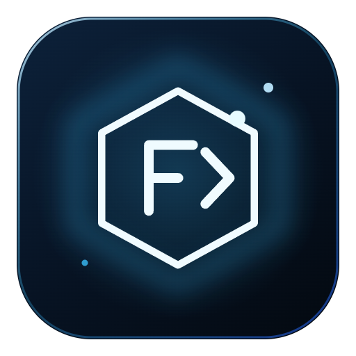
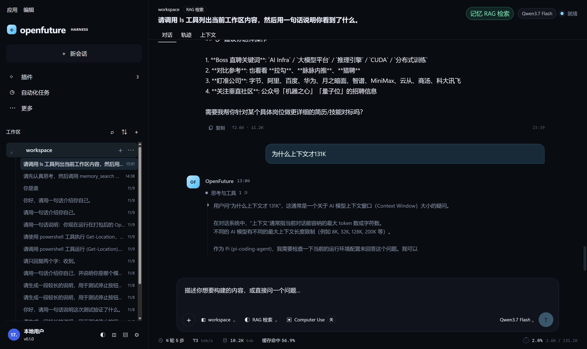
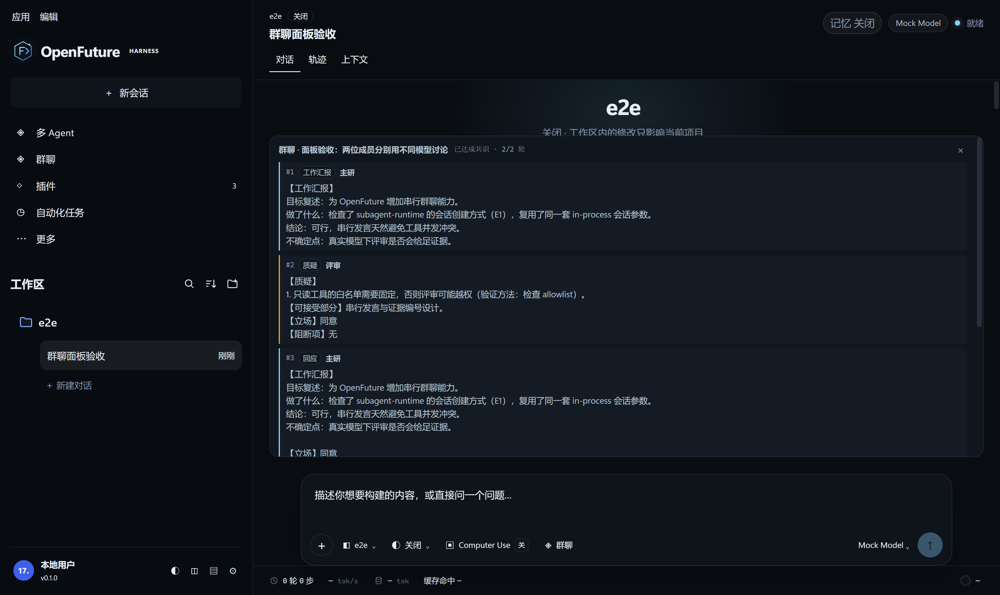
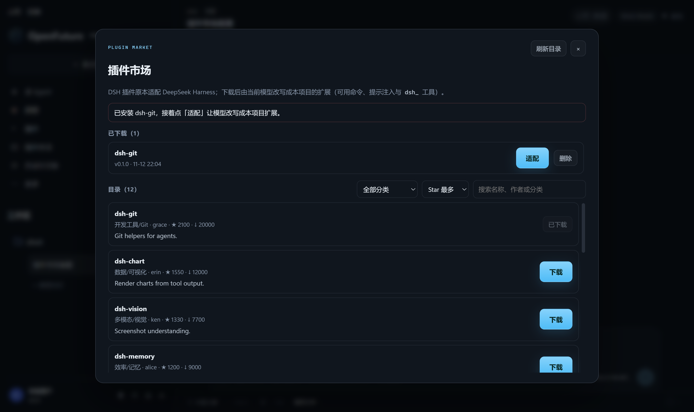
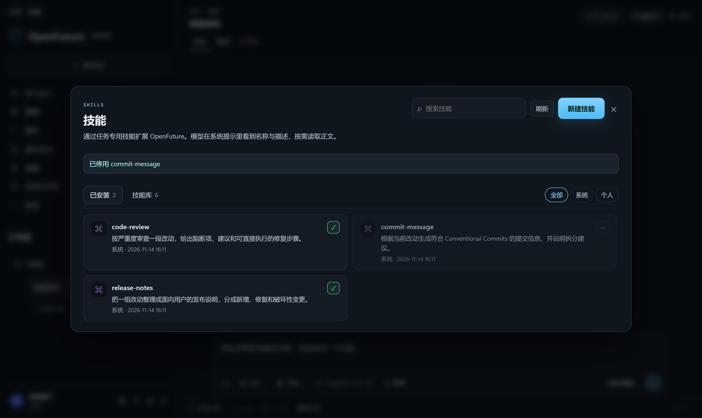
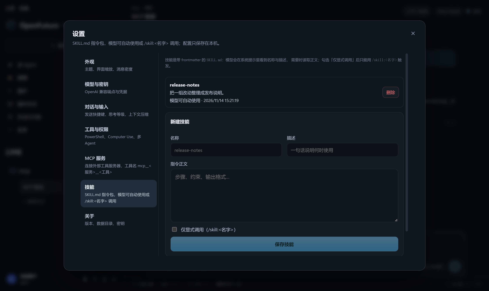
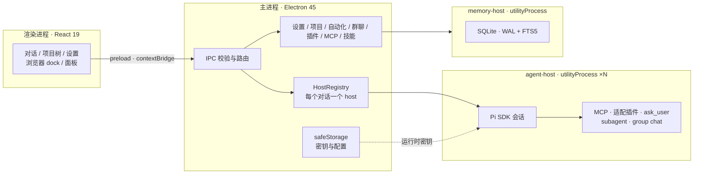
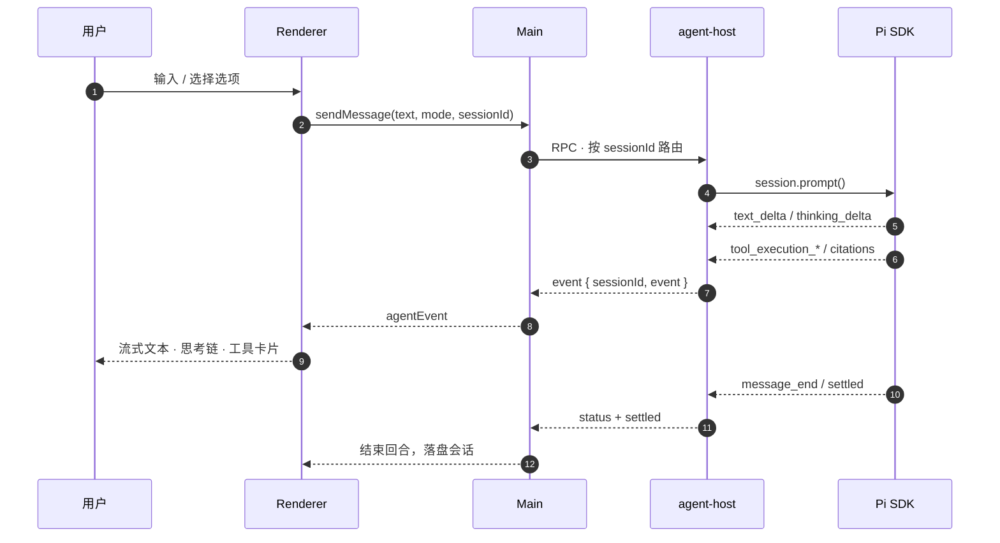
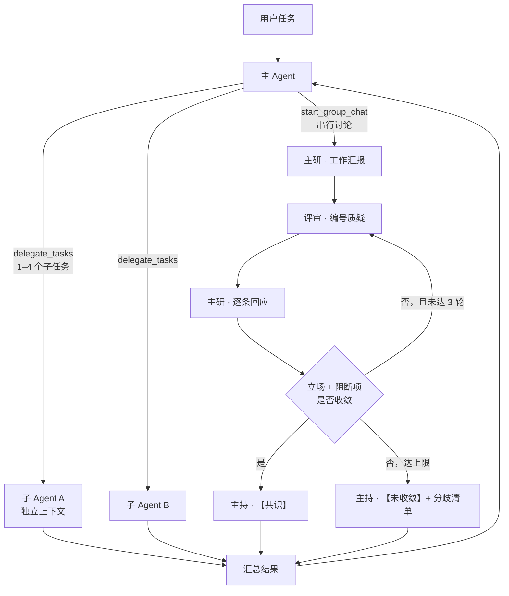
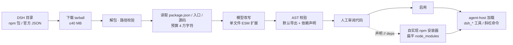

<div align="center">



# OpenFuture

**本地优先的 Windows 桌面 Agent 工作台**

把工作区、长期记忆、多 Agent 协作、插件生态与 MCP 工具，装进一个能陪你长期做项目的桌面应用。

[](https://github.com/Dushiqi1987/OpenFuture)
[](https://github.com/Dushiqi1987/OpenFuture)
[](https://www.electronjs.org/)
[](https://www.typescriptlang.org/)
[](https://react.dev/)
[](https://github.com/earendil-works/pi)
[](LICENSE)

[功能](#-功能全景) · [架构](#-技术架构) · [快速开始](#-快速开始) · [文档地图](#-文档地图) · [路线图](#-路线图)

</div>

---

OpenFuture 是一个 **local-first** 的桌面 Agent：对话、文件、记忆、密钥全部留在本机，模型只通过你配置的 OpenAI 兼容端点访问。它不是为了「再做一个聊天框」，而是把长期项目里真正会反复用到的能力做成基础设施——项目与会话管理、分层记忆与 Dreaming、多 Agent 编排、可扩展的工具生态，以及一个能直接预览 Agent 产物的内置浏览器。

当前版本 `0.1.0`，Windows 11 x64，Node.js ≥ 22.19（开发验证于 Node 24.21）。

## ✨ 为什么是 OpenFuture

- **本地优先**：API Key 用 Windows DPAPI（Electron `safeStorage`）加密，Pi 只拿到运行时注入的临时密钥；`models.json` 里永远是占位符，不落盘明文。
- **进程隔离**：渲染层只接触 DTO；Pi SDK 只在一个 `utilityProcess` 里加载；SQLite 只由 `memory-host` 独占。任何一侧崩溃都不会带走整个应用。
- **多 Agent 是原语，不是外挂**：具名角色会话、并行子 Agent（`delegate_tasks`）、串行群聊（主研 / 评审 / 主持）共用同一套会话、工具与事件管线。
- **可扩展**：DSH 插件市场一键下载，模型把 cordis 插件改写成 Pi 扩展，人工审阅代码后再启用；MCP 服务与 `SKILL.md` 技能开箱即用。
- **可验证**：每个能力都有离线冒烟或 CDP 端到端脚本，验收记录、截图与复现命令随代码一起提交。

## 🧭 功能全景

| 模块 | 能力 | 入口 |
| --- | --- | --- |
| **工作台** | 项目树、多项目对话、草稿、主题（跟随系统/深色/浅色）、界面缩放与消息密度 | 左侧栏 · 设置 |
| **并发对话** | 多个对话同时生成，切走不打断；每个对话一个 agent-host 进程，切回自动回放历史 | 对话列表（运行中显示跳动圆点） |
| **流式对话** | 文本 / 思考 / 工具调用实时渲染；逐步时间线（思考、工具、技能各一行，点开展开全文、参数与工具结果），用量与缓存命中统计 | 主对话区 |
| **回合控制** | 停止、排队、中途引导（steer）、`ask_user` 选项式提问与自定义回答 | 输入框 / 提问卡片 |
| **文件修改** | `write` / `edit` 工具；Codex 风格「已编辑 N 个文件 +X −Y」卡片，逐文件增删行数，点击打开文件 | 主对话区 / 设置 · 工具与权限 |
| **记忆系统** | L0–L3 分层记忆、SQLite FTS5 trigram 中文检索、RAG / Wiki / 混合模式、引用、Dreaming 裁决与发布 | 应用 · 项目记忆 |
| **多 Agent** | 具名角色会话；`delegate_tasks` 并行子 Agent；`start_group_chat` 串行群聊与共识收敛 | 左侧栏 · 多 Agent / 群聊 |
| **插件市场** | 下载 DSH 插件、模型自动改写为 Pi 扩展、依赖安装、代码审阅、启用/停用 | 左侧栏 · 插件市场 |
| **MCP 与技能** | stdio / HTTP MCP 服务管理；`SKILL.md` 技能库、搜索、启停、`/skill:` 调用 | 设置 · MCP 服务 / 左侧栏技能 |
| **文件与浏览器** | 回复中的路径与 URL 自动变链接，HTML 在右侧内置浏览器打开，或交给系统浏览器 | 对话内链接 |
| **自动化** | 一次性 / 间隔 / 每日 / 每周任务，可绑定项目或对话，模型也能自己创建任务 | 左侧栏 · 自动化任务 |
| **Computer Use** | 两套桌面后端：windows-mcp（截图 + 坐标，15 个工具）与 Agent Desktop（无障碍树 + `@ref`，12 个工具）；用户输入门控 | 设置 · 工具与权限 / composer 开关 |
| **网络与时间** | 免费 `web_search`（Exa MCP + AnySearch 回退）、`current_time` 权威时间注入 | 模型工具 |
| **上下文压缩** | `billion-context-pi` ACP 扩展：`compress / decompress / search_context / acp_status` | 设置 · 对话与输入 |

## 🖼️ 界面预览

<table>
  <tr>
    <td width="50%"></td>
    <td width="50%"></td>
  </tr>
  <tr>
    <td align="center">项目化工作台与常显思考链</td>
    <td align="center">多个对话并发运行</td>
  </tr>
  <tr>
    <td width="50%"></td>
    <td width="50%"></td>
  </tr>
  <tr>
    <td align="center">主研 → 评审 → 主持的群聊讨论</td>
    <td align="center">DSH 插件市场：分类、Star 排序、适配</td>
  </tr>
  <tr>
    <td width="50%"></td>
    <td width="50%"></td>
  </tr>
  <tr>
    <td align="center">技能面板：搜索、技能库、启停</td>
    <td align="center">MCP 服务与技能管理</td>
  </tr>
</table>

## 🏗️ 技术架构

### 技术栈

| 层 | 选型 | 说明 |
| --- | --- | --- |
| 桌面壳 | Electron 45 + electron-vite 6 | 主进程 / preload / 渲染进程三段式 |
| 界面 | React 19 + TypeScript 7 | 单页工作台，无重型组件库，样式集中在 `styles.css` |
| Agent 内核 | `@earendil-works/pi-coding-agent@1.5.0` | 会话、工具、扩展、事件流全部由 Pi 提供 |
| 进程模型 | `utilityProcess` | `agent-host` 持有 Pi 与模型调用；`memory-host` 独占 SQLite |
| 存储 | SQLite（WAL + FTS5 trigram）、JSON 配置、Pi JSONL 会话 | 记忆索引、设置/项目/群聊/插件清单、会话历史 |
| 密钥 | Electron `safeStorage`（Windows DPAPI） | 只加密保存，运行时注入 agent-host |
| 上下文压缩 | `billion-context-pi@0.1.83` | 可选的 ACP 压缩扩展与 sidecar |
| 扩展 | Pi Extension API / MCP / `SKILL.md` | 内置 MCP 扩展 + 适配后的 `dsh_*` 插件 |

### 进程边界



**为什么这样切：** Pi SDK 只在 `agent-host` 动态 `import()`，主进程和 preload 不加载它；这样既能用 ESM 与原生依赖，也能让「一个对话卡死」只影响那一个进程。渲染层拿不到文件路径、密钥或 Pi 类型，所有能力都经过 `src/shared/protocol.ts` 的类型化 RPC。

### 一次对话的链路



### 多 Agent 编排



- **子 Agent**：共享工作区、只读工具集、独立取消；不暴露 `delegate_tasks` 本身，结构性防递归。
- **群聊**：每轮只注入未读消息；三层预算（单条 4000 / 每轮 8000 / 转写 12000 字符）；评审只读、证据编号 `E1/E2`、相似度停滞检测，降低「被错误观点带偏」。
- **并发**：`HostRegistry` 默认允许 3 个对话同时运行，超出时先驱逐空闲 host。

### 插件适配流水线



适配产物默认停用；启用前必须过 AST 校验与人工审阅。生成的代码以 Pi 扩展形式运行在 agent-host 进程内，**契约不是沙箱**——这一点在设置与文档里都明确提示。

### 关键设计决策

| 决策 | 取舍 |
| --- | --- |
| 一个对话一个 `utilityProcess` | 隔离崩溃与工具状态，换取每对话一份 Pi 运行时内存；默认上限 3，可按需调低 |
| 单进程单会话的 agent-host | 不改动 Pi 的内部状态机，多会话由主进程 `HostRegistry` 编排 |
| 文本 + 结构化事件协议 | 跨进程调试简单、可回放；相比共享内存少一点性能，但边界清晰 |
| 模型配置写 `models.json` | 复用 Pi 的模型解析与 provider 机制；密钥用环境变量占位，避免落盘 |
| 插件先改写再启用 | DSH（cordis）与 Pi Extension API 不兼容，只能语义迁移；用审阅 + 停用默认值兜底 |

## 📁 目录结构

```text
src/
  main/            Electron 主进程：窗口、单实例、IPC 校验、safeStorage、
                   项目/设置/群聊/插件/MCP/技能存储、HostRegistry、Computer Use
  preload/         contextBridge，只暴露类型化 IPC 方法
  agent-host/      utilityProcess：唯一加载 Pi SDK 的地方
                   Pi 会话、工具注册、MCP、子 Agent、群聊、插件适配、ask_user
  memory-host/     utilityProcess：唯一访问 SQLite 的地方（WAL + FTS5）
  shared/          IPC 协议、DTO、错误码（主/预加载/渲染共享）
  renderer/        React 界面：对话、项目树、设置、群聊/插件/技能面板、内置浏览器
tools/             Mock 模型、CDP 调试与 E2E/冒烟脚本
docs/              设计文档、调研、验收记录与截图
third_party/pi/    Pi v1.5.0 源码（固定 tag，只读参考）
parallel/          独立的多 Agent 原型（未合入主线）
```

## 🚀 快速开始

### 环境

- Windows 11 x64
- Node.js ≥ 22.19（开发验证：24.21.0）
- pnpm 11

> **注意**：若系统 PATH 上的 `node` 是旧版本（例如 v14），请先把 Node 24 放到 PATH 最前，或用完整路径调用 `node` / `pnpm`。

### 安装与运行

```bash
pnpm install
# pnpm 11 可能因 ignored build scripts 返回非零；Electron 二进制需要手动安装：
node node_modules/electron/install.js

# 必须清除这两个环境变量（继承后 Electron 会以纯 Node 模式启动 / Chromium 启动即崩）
unset ELECTRON_RUN_AS_NODE PWD

pnpm dev
```

### 配置模型

打开右上角齿轮（或 `应用 → 模型与密钥`），填入任意 OpenAI Chat Completions 兼容端点：

| 配置项 | 示例（阿里百炼） |
| --- | --- |
| Base URL | `https://dashscope.aliyuncs.com/compatible-mode/v1` |
| 模型 ID | `qwen3.7-flash` |
| 上下文窗口 | `131072` |
| 最大输出 | `65536` |
| 推理 / 思考 | 开启 |
| API Key | 由 `safeStorage` 加密保存 |

> DashScope 不接受 `developer` role，`models.json` 固定 `compat.supportsDeveloperRole: false`。qwen3.7-flash 的 `thinking_budget` 为 32768，`max_completion_tokens` 需大于该值。

### 离线体验（Mock 模型）

```bash
pnpm mock-model
# 设置：Base URL = http://127.0.0.1:8787/v1，模型 ID = mock-model
```

Mock 服务实现 `GET /v1/models` 与 `POST /v1/chat/completions`（SSE），支持流式、工具调用、群聊、插件适配等模式，用于无网络验收。

### 打包

```bash
pnpm package
# 产物：release/win-unpacked/OpenFuture.exe
```

## ⚙️ 配置参考

### 设置分组

| 分组 | 可调项 | 生效方式 |
| --- | --- | --- |
| 外观 | 主题、界面缩放（90%–125%）、消息密度、时间戳 | 立即生效，写入 `settings.json` 的 `ui` 块 |
| 模型与密钥 | Base URL、模型 ID、显示名、上下文窗口、最大输出、推理、API Key | 保存后重启 agent-host |
| 对话与输入 | 发送快捷键（Enter / Ctrl+Enter）、思考等级、上下文压缩 | 快捷键即时；思考等级在新会话生效 |
| 工具与权限 | 文件修改（write/edit）、Computer Use、Agent Desktop（安装/开关）、PowerShell、并行子 Agent + 并发数、群聊 Agent | 保存后重启 agent-host |
| MCP 服务 | stdio / HTTP 传输、启用/停用、删除 | 保存后重载 |
| 技能 | 新建 / 编辑 / 启停 / 技能库安装 | 保存后重载 |
| 关于 | 版本、协议版本、数据目录、密钥状态、清除密钥 | 只读 / 清除需重启 |

### 环境变量

| 变量 | 默认 | 作用 |
| --- | --- | --- |
| `OPENFUTURE_USER_DATA` | `%APPDATA%/OpenFuture` | 覆盖用户数据目录（测试隔离用） |
| `OPENFUTURE_MAX_CONVERSATIONS` | `3` | 同时运行的对话数上限（最小 2） |
| `OPENFUTURE_MCP` | 开启 | 设为 `0` 关闭 MCP 扩展 |
| `OPENFUTURE_SUBAGENTS` | 开启 | 设为 `0` 关闭并行子 Agent |
| `OPENFUTURE_SUBAGENT_CONCURRENCY` | `3` | 子 Agent 并发数（1–4） |
| `OPENFUTURE_GROUP_CHAT` | 开启 | 设为 `0` 关闭群聊 Agent |
| `OPENFUTURE_THINKING_LEVEL` | `medium` | `off / low / medium / high` |
| `OPENFUTURE_ALLOW_POWERSHELL` | 关闭 | 由设置注入，开启后 Agent 才能用 PowerShell |
| `OPENFUTURE_MARKET_CATALOG` | 官方目录 | 本地 JSON（绝对路径或 `file://`）或镜像地址 |
| `OPENFUTURE_NPM_REGISTRY` | `https://registry.npmjs.org` | 插件依赖 / 目录包的 npm 镜像 |
| `OPENFUTURE_UVX` | 自动查找 | `uvx.exe` 绝对路径（Computer Use） |
| `OPENFUTURE_QMD_MODULE` | 关闭 | QMD 词法检索模块路径 |
| `OPENFUTURE_WIKI_MCP` | 关闭 | pi-llm-wiki stdio MCP 入口 |
| `OPENFUTURE_DOCLING_PYTHON` | 关闭 | Docling PDF OCR 的 Python 路径 |

## 🧪 验证与测试

所有脚本都在隔离的 userData / workspace 中运行，不需要真实模型或网络。

```bash
# 类型检查 + 构建
node node_modules/typescript/lib/tsc.js --noEmit -p tsconfig.node.json
node node_modules/typescript/lib/tsc.js --noEmit -p tsconfig.web.json
pnpm build

# Runtime 层冒烟（无需 Electron 窗口）
node tools/subagent-smoke.mjs
node tools/group-chat-smoke.mjs
node tools/plugin-market-smoke.mjs
node tools/plugin-deps-smoke.mjs
node tools/agent-desktop-smoke.mjs

# 桌面端到端（CDP 驱动真实窗口，先 pnpm build）
node tools/e2e-subagent.mjs
node tools/e2e-group-chat.mjs
node tools/e2e-group-panel.mjs
node tools/e2e-plugin-market.mjs
node tools/e2e-ask.mjs
node tools/e2e-file-link.mjs
node tools/e2e-file-change.mjs
node tools/e2e-steps.mjs
node tools/e2e-multi.mjs
node tools/e2e-agent-desktop.mjs
node tools/mcp-smoke.mjs
node tools/skills-panel-smoke.mjs
node tools/settings-smoke.mjs
```

| 能力 | 验证脚本 | 断言要点 |
| --- | --- | --- |
| 并行子 Agent | `subagent-smoke.mjs` / `e2e-subagent.mjs` | 3 路并发、父会话链接、进度条渲染、结果汇总 |
| 群聊 Agent | `group-chat-smoke.mjs` / `e2e-group-chat.mjs` | 共识与未收敛两条路径、角色顺序、成员模型、历史落盘 |
| 插件市场 | `plugin-market-smoke.mjs` / `e2e-plugin-market.mjs` | 目录 → 安装 → mock 适配 → 审阅启用 → 工具可用 |
| 插件依赖 | `plugin-deps-smoke.mjs` | semver 解析、传递依赖、ESM 导入、404 处理 |
| MCP / 技能 | `mcp-smoke.mjs` | 模型实际收到 `mcp__demo__echo`、`/skill:` 正文展开 |
| 技能面板 | `skills-panel-smoke.mjs` | 搜索、技能库安装、启停、详情 |
| 并发对话 | `e2e-multi.mjs` | 两个 session 独立 settled、两个 host、切回回放 |
| 设置 | `settings-smoke.mjs` | 外观持久化、思考等级重启、空配置可用 |
| 提问 / 文件链接 | `e2e-ask.mjs` / `e2e-file-link.mjs` | 选项与自定义回答、webview 打开本地 HTML |
| 文件修改卡片 | `e2e-file-change.mjs` | mock 调用 `write` → host 发 `file-change` → 卡片「已编辑 1 个文件 +5 −0」且文件真实写入 |
| 思考 / 工具时间线 | `e2e-steps.mjs` | 思考行折叠预览、点开展开全文；工具行展开含参数与结果；`/skill:` 单独成行 |

## 📚 文档地图

| 文档 | 内容 |
| --- | --- |
| [多 Agent 实现方案调研与适配](docs/多Agent实现方案调研与适配-2026-11.md) | 四类多 Agent 形态、开源项目对比、子 Agent 设计 |
| [群聊 Agent 调研与适配](docs/群聊Agent调研与适配-2026-11.md) | GroupChat / Phase / MsgHub / 互评四类形态、收敛与防带偏 |
| [DSH 插件市场与适配](docs/插件市场与DSH插件适配-2026-11.md) | cordis 插件格式、目录数据源、适配契约与安全边界 |
| [MCP 与技能](docs/MCP与技能-验收记录.md) | MCP 配置、工具命名空间、`SKILL.md`、参考项目 |
| [并发对话](docs/并发对话-验收记录.md) | HostRegistry、每对话一进程、回放与上限 |
| [设置面板](docs/设置面板-验收记录.md) | 五组设置、字段校验、即时/重启语义 |
| [文件链接与内置浏览器](docs/文件链接与内置浏览器-验收记录.md) | 业界实现对照、webview 安全边界 |
| [文件修改与差异卡片](docs/文件修改与差异卡片-验收记录.md) | write/edit 工具、工作区写策略、逐文件增删统计 |
| [思考与工具时间线](docs/思考与工具时间线-验收记录.md) | 步骤模型、`<details>` 展开、工具参数/结果捕获、skill 行 |
| [模型提问与确认](docs/模型提问与确认-验收记录.md) | `ask_user` 契约、阻塞式工具、取消语义 |
| [Agent Desktop 适配](docs/Agent-Desktop-适配-验收记录.md) | 无障碍树后端、12 个桌面工具、安装与验证 |
| [记忆架构](docs/架构-项目与记忆运行时.md) | L0–L3、Dreaming、检索与引用 |
| [测试与隔离环境](docs/测试-隔离环境与Mock.md) | CDP 验收、Mock 模型、隔离 profile |

全部验收记录位于 [`docs/`](docs/)，命名格式为 `<能力>-验收记录.md`。

## 🗺️ 路线图

| 阶段 | 内容 |
| --- | --- |
| **近期** | 写工具逐命令预览与批准、引用持久化、后台对话完成后的列表刷新、插件目录断点续传 |
| **下一步** | 子 Agent worktree 隔离、`background` 完成后重入父回合、插件 worker 隔离与版本升级 |
| **中期** | 语义质量评审与 embedding 漂移、远程设备分用途授权、多窗口与自动更新 |
| **工程化** | asarUnpack 体积优化、代码签名、崩溃上报、CSP 开发模式、日志持久化 |

## ⚠️ 已知限制

- **未签名**：安装包没有代码签名，Windows SmartScreen 会提示。
- **asar 关闭**：为兼容 Pi 的 ESM、原生 `.node` 与 wasm 依赖，目录约 440 MB。
- **写工具无逐次审批**：`write` / `edit` 默认开启（设置可关），写操作只受工作区策略约束，没有逐次确认；PowerShell 是粗粒度开关，开启后没有逐命令预览。
- **差异卡片不持久化**：重新打开对话后只回放回答与工具名，不重新计算每个文件的增删行数。
- **插件适配不是沙箱**：生成代码在 agent-host 进程内运行，契约只是提示词约束；依赖只做扁平安装，不支持多版本共存或原生模块编译。
- **子 Agent 无 worktree 隔离**：并行写同一批文件会互相覆盖，写任务建议串行。
- **群聊成本**：2 轮讨论约 4–6 次完整推理；同模型互评容易客套，高价值任务建议换模型或人工复核。
- **并发对话**：后台完成后侧边栏不自动重排；每个并发对话各占一份 Pi 运行时内存。
- **Dreaming 为确定性 planner**：不调用 LLM，质量门是结构性指标。
- **Computer Use 高权限**：桌面工具直接操作用户桌面，建议只在可信任务中临时开启。
- **Agent Desktop 依赖无障碍权限**：Windows 需允许应用访问辅助功能；CLI 版本随应用固定（1.3.1），暂不支持应用内升级。

## 🔐 安全与隐私

- 模型密钥经 `safeStorage`（DPAPI）加密，仅主进程可解密；agent-host 通过运行时环境变量拿到临时密钥。
- 渲染层启用 `contextIsolation`、关闭 `nodeIntegration`；所有 IPC 在主进程做参数校验。
- 内置浏览器使用 `webview`：清空 preload、禁用 Node、限制导航与 `window.open`，外链交给系统浏览器。
- 插件、MCP 服务与技能由第三方提供内容；启用前请确认来源可信，插件代码可在面板中完整审阅。
- 记忆、会话、插件与配置全部存放在本机 `<userData>`，不主动上传。

## 🤝 贡献

欢迎提交 Issue / PR。开发前请阅读 [并行开发与合入规则](docs/OpenFuture-并行开发与合入规则.md)；提交前至少跑通 `pnpm typecheck`、`pnpm build`，涉及 UI/Agent 的改动请附带对应冒烟或 E2E 输出。

## 📄 许可证

本项目基于 [MIT License](LICENSE) 开源。

感谢这些开源项目： [Pi](https://github.com/earendil-works/pi)（Agent 内核，MIT）、[DeepSeek Harness](https://github.com/deepseek-ai/deepseek-harness)（插件目录与 DSH 生态）、[billion-context-pi](https://github.com/ranxianglei/billion-context)（上下文压缩）、[anthropics/skills](https://github.com/anthropics/skills)（SKILL.md 规范实践）、[modelcontextprotocol](https://github.com/modelcontextprotocol)（MCP 规范与 SDK）。

<div align="center">

**Built with Pi SDK · Runs locally · Made for long projects**

</div>
