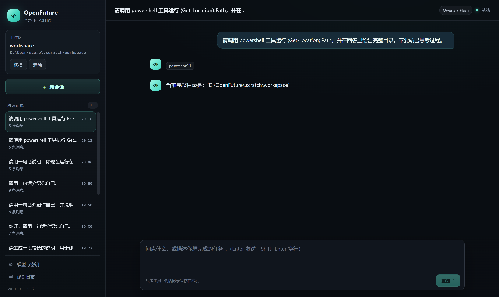

# OpenFuture

GitHub: https://github.com/Dushiqi1987/OpenFuture

本地优先的 Windows 桌面 Agent，基于 [Pi](https://github.com/earendil-works/pi) SDK（`@earendil-works/pi-coding-agent@1.5.0`）二次开发。

当前进度：**P0–P3、P3.1–P3.4、v0.2 A 与 B0 完成；DSH 风格常显思考链、会话状态栏与回答尾部操作完成**。P0 桌面底座（流式对话、停止、恢复、FTS5、PowerShell 授权）、P0.1 安全修复（工具边界、凭证绑定）、P1 记忆层（L0–L2、RAG/Wiki/组合、引用）、P2 Dreaming（裁决/发布/回滚/撤销、L3 注入）、P3 质量门/预算/空闲调度、P3.1 撤销过滤/正则 Worker/历史清理、P3.2 会话取证与错笔记纠正、P3.3 可选 QMD 词法检索与 pi-llm-wiki MCP 检索、P3.4 OF-01～OF-05 安全整改（证据依赖、陈旧候选、工具结果按条目过滤、Wiki 工作区隔离与详情）均已实现并留有验证记录。v0.2 A 增加 Codex 风格项目树/多项目对话/草稿/主题/旧数据迁移，并提供独立候选。默认仍使用 SQLite FTS5；QMD/Wiki 通过外部可选路径启用，失败自动回退 FTS5。



## 功能

- **工作区与会话**：选择本地工作区；会话列表、恢复历史会话；新会话。
- **流式对话**：文本增量渲染，推理模型（如 qwen3.7-flash）的思考/工具调用以 DSH 风格常显链展示，一个回合一个头像。
- **停止**：中断当前流式输出，保留已生成内容并落盘。
- **模型配置**：任意 OpenAI Chat Completions 兼容服务；Base URL、模型 ID、上下文窗口、最大输出 token、推理开关。
- **密钥安全**：API Key 使用 Windows DPAPI（Electron `safeStorage`）加密保存；Pi 通过环境变量注入密钥，`models.json` 只写 `$OPENFUTURE_MODEL_API_KEY` 占位符，不落盘明文。
- **独立记忆进程**：`memory-host` utilityProcess 独占 SQLite；WAL + FTS5（trigram）自检，支持中文三字以上查询。
- **诊断面板**：查看主进程/Agent/Memory 进程日志。
- **PowerShell 显式授权**：默认关闭；在「模型与密钥」中手动开启后，Agent 工具列表才会加入 `powershell`。
- **免费网络搜索**：内置 `web_search`，使用 AnySearch 匿名接口并在失败时回退 Exa 公共 MCP，无需 API Key；详细说明见 `docs/Free-Web-Search-接入-验收记录.md`。

## 快速开始

### 环境

- Windows 11 x64
- Node.js >= 22.19（本项目使用 Node 24.21 验证）
- pnpm 11

> 本机系统 PATH 上的 `node` 是 v14，不能用于本项目。请把 Node 24 放到 PATH 最前，或使用完整路径调用。示例：
>
> ```bash
> export PATH="/c/Users/杜世旗/.dsh/dsh-runtimes/dsh-primary-runtime/dependencies/node/bin:$PATH"
> NODE="/c/Users/杜世旗/.dsh/dsh-runtimes/dsh-primary-runtime/dependencies/node/bin/node.exe"
> PNPM="/c/Users/杜世旗/.dsh/dsh-runtimes/dsh-primary-runtime/dependencies/pnpm/bin/pnpm.mjs"
> "$NODE" "$PNPM" install
> ```

### 安装依赖

```bash
pnpm install
# pnpm 11 可能因 ignored build scripts 返回非零；Electron 二进制需要手动安装：
node node_modules/electron/install.js
```

依赖与 Electron 二进制镜像已配置在 `.npmrc`（npmmirror）。

### 开发运行

```bash
# 必须清除这两个环境变量：
# - ELECTRON_RUN_AS_NODE：继承后 Electron 会以纯 Node 模式启动，没有 app 对象
# - PWD：MSYS 风格的 PWD（如 /d/OpenFuture）会让 Chromium 启动即崩
unset ELECTRON_RUN_AS_NODE PWD

pnpm dev
```

### 使用 Mock 模型（离线验证 UI）

```bash
pnpm mock-model
# 模型设置：Base URL = http://127.0.0.1:8787/v1，模型 ID = mock-model
# 上下文窗口 128000，最大输出 8192
```

Mock 服务实现了 `GET /v1/models`、`POST /v1/chat/completions`（SSE 流式），会回显最后一条用户消息，用于验证流式、停止、恢复。

### 可选检索引擎（QMD / pi-llm-wiki）

默认使用内置 FTS5，不需要额外依赖。若要启用外部引擎，启动前设置环境变量：

```bash
# QMD：索引当前工作区 active evidence，失败自动回退 FTS5
export OPENFUTURE_QMD_MODULE="D:/path/to/qmd/node_modules/@tobilu/qmd/dist/index.js"

# pi-llm-wiki：通过 stdio MCP 调用 wiki_recall，失败只影响 Wiki 命中
export OPENFUTURE_WIKI_MCP="D:/path/to/pi-llm-wiki/dist/mcp/index.js"
export OPENFUTURE_WIKI_ROOT="D:/path/to/wiki/vault"
```

- QMD 索引位于用户数据目录 `memory/qmd/<workspaceId>/`，撤销 source 后对应 evidence 会从语料和结果中消失。
- Wiki 命中只读展示 recall 的 preview，不写入本地 Wiki 草稿；模式为 `wiki` 或 `both` 时才查询。
- 两个引擎都是可选外部资源，界面搜索提示会显示实际引擎与回退原因。
- 设置 `OPENFUTURE_QMD_HYBRID=1` 可尝试 QMD 向量与关键词混合检索。该路径需要 QMD 模型权重，失败时使用关键词检索，超时时使用 FTS5。
- 设置 `OPENFUTURE_DOCLING_PYTHON` 为已安装 Docling 的 Python 可执行文件绝对路径，可启用 PDF OCR。解析失败时使用内置 PDF 文本解析器。
- 上下文压缩默认启用 `billion-context-pi@0.1.83`：在 `插件 → 上下文压缩` 或设置中切换。启用后 agent-host 加载 ACP 扩展，提供 `compress / decompress / search_context / acp_status / acp_cache`，压缩块与 sidecar 写入用户数据目录和 `acp.log`；关闭后使用 Pi 原生压缩。

### Computer Use（Windows 桌面）

Computer Use 默认关闭。打开 `插件 → Computer Use`，或 composer 的 Computer Use 开关，应用会按需启动本地 `windows-mcp` MCP 服务；关闭开关会使 agent-host 重启并移除全部桌面工具。

前置条件：

```powershell
irm https://astral.sh/uv/install.ps1 | iex
uvx windows-mcp@0.8.8 --help
```

说明：

- OpenFuture 只申请 15 个白名单工具（截图、快照、点击、输入、滚动、移动、快捷键、剪贴板、等待、通知等），不申请 PowerShell、文件系统、注册表、启动应用、网页抓取或进程管理工具。
- 桌面工具会直接操作用户当前桌面，属于高权限能力；请只在你信任的任务中临时打开。
- Windows-MCP 有用户输入门控：点击、移动、输入等动作要求桌面空闲约 10 秒；OpenFuture 会自动等待并重试，`USER_CONTROL` 只表示用户刚操作过，不是故障。截图、快照和状态查询不受此限制。
- 已真机验证截图与鼠标移动；点击、输入等动作尚未逐项验证。首次启动需要 uv 准备 Python 依赖，可能耗时数十秒。
- 可用 `OPENFUTURE_UVX` 指定 `uvx.exe` 的绝对路径；默认查找 `%USERPROFILE%\.local\bin\uvx.exe`。

桌面记忆库的「Wiki」页可生成当前项目的多来源主题草稿，展开查看正文和差异，再审核发布。旧版发布页在新草稿审核期间仍可检索。

「协作运行」页可读取已落盘的多 Agent 运行摘要。为同一个项目启动 `parallel/multiagent/scripts/desktop-bridge.ts`，使用端口 19744，通过 `--project-id` 指定运行快照中的项目 ID。桌面启动环境中的 `OPENFUTURE_TEAM_BRIDGE_PROJECT_ID` 必须与桌面项目 ID 一致，`OPENFUTURE_TEAM_BRIDGE_TOKEN` 与桥的 `DESKTOP_BRIDGE_TOKEN` 一致。

### 打包

```bash
pnpm package
```

产物：

- `release/win-unpacked/OpenFuture.exe`：P0 基线免安装目录（保留）
- `release/p0.1-runnable/OpenFuture.exe`：P0.1 安全修复候选
- `release/p1-runnable/OpenFuture.exe`：P1 记忆层候选
- `release/p2-runnable/OpenFuture.exe`：P2 Dreaming 候选
- `release/p3-runnable/OpenFuture.exe`：P3 调度质量候选
- `release/p3.1-security-runnable/OpenFuture.exe`：P3.1 安全整改候选（撤销 L3 过滤、grep 正则 Worker、历史工具结果清理）
- `release/p3.2-evidence-runnable/OpenFuture.exe`：P3.2 取证与纠正候选（会话导入证据、fix 候选、撤销证据拒绝、纠正后刷新 L3；新会话 system 注入已用 mock 复验）
- `release/p3.3-qmd-wiki-runnable/OpenFuture.exe`：P3.3 可选检索引擎候选（QMD + pi-llm-wiki MCP、引擎标识、FTS5 回退）
- `release/p3.4-security-runnable/OpenFuture.exe`：P3.4 安全整改候选（OF-01～OF-05：证据依赖撤销过滤、陈旧纠正候选、记忆工具结果条目级过滤、Wiki 工作区隔离与详情读取）
- `release/v0.2-a-projects-runnable/OpenFuture.exe`：v0.2 A 项目化外壳候选（最新；三栏项目树、多项目对话、草稿、主题、旧数据迁移；浅蓝强调色）
- `release/OpenFuture-0.1.0-x64-setup.exe`：P0 时期的 NSIS 安装包（131 MB，未随 P1–P3 重打）

启动打包版同样需要清理环境变量：

```bash
unset ELECTRON_RUN_AS_NODE PWD
./release/v0.2-a-projects-runnable/OpenFuture.exe
```

## 目录结构

```text
src/
  main/            Electron 主进程：窗口、单实例、IPC 校验、safeStorage、进程管理
  preload/         contextBridge，只暴露类型化 IPC 方法
  agent-host/      utilityProcess：唯一加载 Pi SDK 的地方，会话与事件映射
  memory-host/     utilityProcess：唯一访问 SQLite 的地方
  shared/          IPC 协议、DTO、错误码（主进程/预加载/渲染层共享）
  renderer/        React UI（只接收 DTO，不接触文件路径/密钥/Pi 类型）
tools/             CDP 调试与验收脚本、Mock 模型服务
third_party/pi/    Pi v1.5.0 源码（固定 tag，只读参考）
```

## 架构要点

- **进程边界**：渲染层 → preload → 主进程 → `utilityProcess`（agent-host / memory-host）。Pi SDK 只在 agent-host 中动态 `import()`，主进程和 preload 不加载 Pi。
- **会话**：`SessionManager` 使用用户数据目录下的 `pi/agent/sessions`；agent-host 负责 `open/send/stop/close`，主进程只转发事件。
- **工具**：默认只读 `read/grep/find/ls`；`powershell` 需要显式开关，由主进程通过 `OPENFUTURE_ALLOW_POWERSHELL=1` 注入 agent-host。
- **模型**：主进程把模型配置写成 `models.json`，provider 固定 `openfuture`，`api: openai-completions`，密钥用 `$OPENFUTURE_MODEL_API_KEY` 环境插值。
- **兼容性**：DashScope 不接受 `developer` role，`models.json` 固定 `compat.supportsDeveloperRole: false`。

## 当前模型配置

当前验证模型为阿里百炼 `qwen3.7-flash`：

| 配置项 | 值 |
| --- | --- |
| Base URL | `https://dashscope.aliyuncs.com/compatible-mode/v1` |
| 模型 ID | `qwen3.7-flash` |
| 上下文窗口 | 131072 |
| 最大输出 token | 65536 |
| 推理/思考 | 开启 |

> qwen3.7-flash 默认 `thinking_budget` 为 32768，DashScope 要求 `max_completion_tokens` 大于该值，因此最大输出设为 65536。其他模型可按实际上限调整。

## P0 验收结果

2026-11-08 在 **打包后的 `release/win-unpacked/OpenFuture.exe`** 中完成：

| 验收项 | 结果 | 证据 |
| --- | --- | --- |
| ESM SDK 导入 | 通过 | agent-host 启动，真实 qwen 对话返回 |
| utilityProcess 通信 | 通过 | 会话/流式事件经主进程转发到 UI |
| SQLite FTS5 | 通过 | SQLite 3.53.4，trigram，中文「记忆库」命中 1 条 |
| Pi 事件流 | 通过 | text_delta / thinking_delta 实时渲染 |
| 取消 | 通过 | `tools/cdp-stop-test.mjs` 点击停止，状态收敛、无残留 stop 按钮 |
| 会话恢复 | 通过 | 停止后点击会话项，恢复 user + 部分 assistant 消息 |
| Windows PowerShell 工具 | 通过 | 开启授权后 `(Get-Location).Path` 返回工作区路径 |
| NSIS 安装包 | 通过 | `release/OpenFuture-0.1.0-x64-setup.exe` |

复验脚本（需要应用以 `--remote-debugging-port=9222` 或 `9223` 启动）：

```bash
CDP_PORT=9223 node tools/cdp-chat.mjs "请用一句话介绍你自己。"
CDP_PORT=9223 node tools/cdp-stop-test.mjs
CDP_PORT=9223 node tools/cdp-eval.mjs "window.openfuture.memoryDiagnostics().then(r => JSON.stringify(r))"
```

## 已知限制

- **未签名**：安装包没有代码签名，Windows SmartScreen 会提示。
- **asar 关闭**：为兼容 Pi 的 ESM、原生 `.node` 与 wasm 依赖，当前 `asar: false`，目录约 440 MB。后续可改为 asar + `asarUnpack`。
- **写工具审批未实现**：Agent 默认仅只读工具（read/grep/find/ls + 记忆只读工具）；PowerShell 是粗粒度开关，开启后没有逐命令预览/批准。
- **Dreaming 为确定性 planner**：不调用 LLM，phase 固定 promote；质量门是结构性指标，没有 embedding 漂移、语义评审或纠错率 ≥ 70%。自动调度只生成待审任务，不自动发布。
- **引用不持久化**：citations 仅实时显示，重开会话不恢复；thinking 块可恢复。
- **无自动更新**、无崩溃上报、无多窗口。
- 开发模式没有注入 CSP；生产构建已由 Vite 插件注入 `script-src 'self'` 的 CSP。
- 诊断日志不重放启动期日志，只显示订阅之后的内容。

## 与设计文档的偏离

设计文档位于 `F:\VibelutionRuntimes\Windows桌面版Pi-Agent开发设计方案.md`。P0 实现有以下记录在案的偏离：

1. **打包器**：使用 electron-builder + NSIS，而非文档建议的 Electron Forge Squirrel.Windows。文档标注 Squirrel「可用」而非强制；NSIS 在中文 Windows 上更稳定，支持安装目录选择。
2. **仓库形态**：单包应用（根目录即 Electron app），而非 pnpm monorepo。electron-builder 对 workspace 符号链接打包易出错；模块边界通过 `src/main`、`src/agent-host` 等目录体现。
3. **模型供应商**：按用户要求接入阿里百炼 qwen3.7-flash，而非文档示例中的默认供应商。
4. **P0 范围**：本次只交付桌面底座与验收；记忆四层、Dreaming 五阶段、调度质量属于 P1–P3。

## 下一步

- P1 收尾：引用持久化、导入对话框自动化、QMD/Wiki adapter 化（当前运行期为 FTS5 + 确定性草稿）。
- P2/P3 增强：LLM 裁决与语义质量评审、embedding 漂移、纠错率统计、阶段进度持久化。
- 写工具逐命令预览与批准绑定（edit/write/bash），以及远程调用分用途授权。
- 工程：asarUnpack 优化体积、代码签名、自动更新、崩溃恢复、CSP 开发模式、日志持久化。
- 验收记录：`docs/P0.1-验收记录.md`、`docs/P1-验收记录.md`、`docs/P2-验收记录.md`、`docs/P3-验收记录.md`。

## 许可证

MIT。Pi 上游为 MIT，见 `third_party/pi/LICENSE`。
