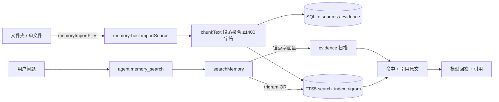

# RAG 链路评测（2026-11）

目标：回答三个问题——桌面版 RAG 链路是否真正打通、用 100 个文件能否跑通并量化效果、有哪些开源评测项目可以借鉴。

## 1. 结论

- **链路已打通**：100 个 Markdown 文件 → 分块 → SQLite `sources`/`evidence` + FTS5 索引 → `memory_search` 工具 → 模型回答并带引用，已在真实桌面进程用 mock 模型端到端验证。
- **发现并修复一个真实缺陷**：FTS5 使用 `trigram` 分词器，而查询侧把整句按空格切成词并用 `AND` 连接，中文自然语言问题（如「HALCYON-001 的默认阈值是多少」）永远返回 0 条。修复后同一问题命中正确文档。
- **纯词法检索的边界很清楚**：精确标识符/数字 100% 命中；换一种说法（paraphrase）R@1 为 0；跨文档对比 R@1 45%。向量/重排缺位是主要短板。
- **评测工具**：本地 BEIR 风格脚本（本仓库）足以日常回归；端到端质量建议接 promptfoo，RAG 指标建议 RAGAS / DeepEval。

## 2. 链路



- 导入：`src/main/ipc.ts` 的 `memoryImportFiles`（文件夹选择或显式路径，单次 ≤100 个、单文件 ≤2 MB）→ `memory-host` 的 `importSource` → `chunkText` → `sources`/`evidence` → `indexDoc` 写 FTS5。
- 检索：`src/memory-host/index.ts` 的 `searchMemory`：锚点（ASCII 标识符/数字）字面量匹配 → FTS5 trigram 查询 → 命中回表（`loadHit`）→ 返回 `MemorySearchHit`（`citation.origin` 指回文件）。
- 工具：`src/agent-host/memory-tools.ts` 按 `memoryMode` 暴露 `memory_search`/`memory_get`；`mode=rag` 时检索 evidence/note/wiki。

## 3. 评测方法与结果

语料：`tools/rag-corpus.mjs` 生成 100 篇 Markdown（10 个主题 × 10 篇），每篇含唯一服务代码（如 `HALCYON-001`）、唯一默认阈值（10–109 秒）、负责人，以及跨文档复用的模板段落作为干扰。查询 230 条：

| 类型 | 数量 | 构造方式 |
| --- | ---: | --- |
| exact | 100 | `<服务代码> 的默认阈值是多少` |
| value | 100 | `哪个服务的默认阈值是 <N> 秒` |
| compare | 20 | `<代码A> 与 <代码B> 的默认阈值分别是多少` |
| paraphrase | 10 | `<主题> 第 <章节> 章的超时配置`（不同说法，无标识符） |

运行：`node tools/rag-corpus.mjs && node tools/rag-eval.mjs`（Electron + CDP，memoryMode=rag）。

| 分组 | 查询数 | Recall@1 | Recall@5 | Recall@10 | MRR | nDCG@10 | p50 | p95 |
| --- | ---: | ---: | ---: | ---: | ---: | ---: | ---: | ---: |
| 总体 | 230 | 90.4% | 92.8% | 97.2% | 0.933 | 0.932 | 5.3 ms | 7.6 ms |
| exact | 100 | 100.0% | 100.0% | 100.0% | 1.000 | 1.000 | 5.3 ms | 8.0 ms |
| value | 100 | 99.0% | 99.0% | 99.0% | 0.990 | 0.990 | 5.5 ms | 7.6 ms |
| compare | 20 | 45.0% | 72.5% | 72.5% | 0.725 | 0.622 | 5.1 ms | 6.0 ms |
| paraphrase | 10 | 0.0% | 0.0% | 100.0% | 0.111 | 0.301 | 4.0 ms | 4.9 ms |

- 导入 100 份文件耗时约 0.6 s；检索 p50 约 5 ms。
- `value` 唯一未命中是「20 秒」被 `第 2 章`/时间等噪声分散了排序，属于词法排序的典型弱点。
- `paraphrase` 的 R@10=100% 说明候选集里其实存在正确文档，只是没有语义信号把它排到前面。

## 4. 发现的问题与修复

**现象**：任何带中文问题的查询都返回 0 条（`memorySearch` 空数组），只有单词（如 `HALCYON-001`、`默认阈值`）能命中。

**根因**（`src/memory-host/index.ts`）：

1. 索引是 `CREATE VIRTUAL TABLE search_index USING fts5(..., tokenize = 'trigram')`，trigram 只能匹配长度 ≥3 的连续子串。
2. `ftsQuery()` 用 `[\p{L}\p{N}_-]+` 切词后以 `AND` 连接；中文没有被分词，整句「的默认阈值是多少」被当成一个 token，而 trigram 表里不存在这个连续三元组，于是 MATCH 失败。
3. 失败后回退的 `LIKE '%整句%'` 同样要求整句连续出现，也必然失败。

**修复**：

- `ftsQuery()` 改为「重叠三元组 OR」：把每个 token 展开为 3 字符窗口（`"的默认" OR "默认阈" OR ...`），由 BM25 按命中数量排序。
- 新增 `queryAnchors()`：提取 ASCII 标识符/数字（≥2 字符），先在 `evidence`/`notes`/`wiki_pages` 正文里做字面量 AND 匹配，把最selective的命中放在最前面；这样 `37` 这类小于三元组长度的数字也能精确命中。
- 保留原有 `LIKE` 回退作为最后兜底。

修复后 exact 从 0% → 100%，总体 R@1 从 0% → 90.4%。

## 5. 开源评测项目

| 项目 | ★（2026-11-16） | 许可 | 定位 | 与本项目的关系 |
| --- | ---: | --- | --- | --- |
| promptfoo/promptfoo | 27,228 | MIT | 端到端 LLM/Agent 评测，含 `context-faithfulness`、`context-recall` 等 RAG 断言 | 适合做「回答是否忠于检索证据」的回归；可接 OpenAI 兼容模型，mock/真实模型都能跑 |
| confident-ai/deepeval | 19,489 | Apache-2.0 | pytest 风格评测框架，RAG 三件套（faithfulness/answer relevancy/context precision & recall） | 如果团队用 Python，可作为答案层质量门禁 |
| vibrantlabsai/ragas | 16,327 | Apache-2.0 | RAG 专用指标库（context precision/recall、faithfulness、answer correctness） | 指标定义与我们的检索指标互补，可复用其 prompt 模板 |
| truera/trulens | 3,652 | MIT | RAG triad 追踪（groundedness/context relevance/answer relevance） | 适合观测线上检索-回答链路 |
| beir-cellar/beir | 2,334 | Apache-2.0 | 检索基准与标准指标（nDCG@10、Recall@100、MRR） | 本次评测脚本即按 BEIR 口径实现，可直接对照公开分数 |

选型建议：

1. **日常回归**：保留 `tools/rag-eval.mjs`（无外部依赖、真实桌面链路、秒级完成）。
2. **答案质量**：接 promptfoo 或 RAGAS；本机 Python 3.10 已可用，但需要安装 `ragas`/`deepeval` 及其依赖。
3. **公开对比**：如需对外汇报，按 BEIR 协议导出检索结果（已给出 qrels 结构），避免只报自造数据。

## 6. 端到端证据

`tools/e2e-memory-rag.mjs`：真实桌面进程、mock 模型、100 文件、`mode=rag`。模型调用 `memory_search`，工具返回 `storage-01.md` 的原文片段（含「默认阈值：10 秒」），回答中回显「记忆检索结果」，界面显示 `memory_search · HALCYON-001 的默认阈值是多少` 步骤行与引用来源列表。输出 `E2E PASSED`，截图 `.scratch/e2e-memory-rag.png`。

## 7. 限制与下一步

- **没有向量检索**：当前只有 trigram 词法；同义改写、跨语言、长文档语义匹配都会掉分。QMD 适配器存在但需外部安装（`OPENFUTURE_QMD_MODULE`），尚未接入真实模型。
- **没有 reranker**：候选只靠 BM25；compare/多跳问题排序弱。
- **没有答案层指标**：本次只评检索（Recall/MRR/nDCG），未评 faithfulness/答案正确率。
- **分块策略简单**：按段落聚合到 ≤1400 字符，标题不参与检索（只存 heading 元数据）。
- **单文件 2 MB / 单批 100 个**：适合文档库，不适合超大资料集。

下一步优先级：

1. 接入真实 embedding（QMD 或本地模型）+ RRF 融合，重跑同一套脚本对比。
2. 加 reranker（cross-encoder 或 QMD rerank）并观察 compare/paraphrase 指标。
3. 把答案层评测接进 CI（promptfoo + mock 模型最小回归，真实模型定期跑）。

## 8. 复现

```bash
node tools/rag-corpus.mjs          # 生成 100 篇语料与 230 条查询
node tools/rag-eval.mjs            # 真实桌面链路评测，输出 .scratch/rag-eval/report.{json,md}
node tools/e2e-memory-rag.mjs      # 端到端：模型调用 memory_search 并带引用回答
```

报告字段：`metrics.overall`、`metrics.byType`（exact/value/compare/paraphrase）、`importMs`、`engine`。
