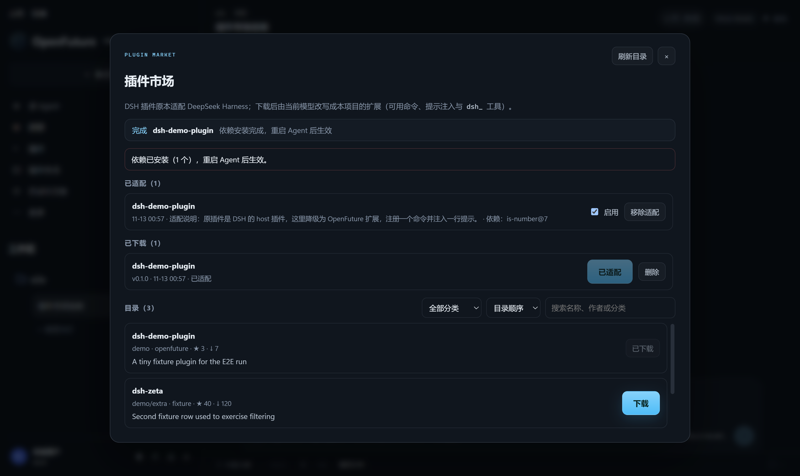

# 插件市场与 DSH 插件适配 · 验收记录（2026-11-12）

## 1. 范围

| 能力 | 状态 |
| --- | --- |
| 左侧栏「插件市场」面板（目录 / 已下载 / 已适配） | 已验收 |
| 目录拉取与磁盘缓存（TTL 6h，可配置地址） | 已验收（本地 fixture；官方 14.6 MB 目录受本机网络断流限制，见 §6） |
| 下载 `.tgz`、解包、路径安全校验 | 已验收 |
| 模型适配：源码 → 单文件 Pi 扩展（命令 / 事件 / `dsh_` 工具） | 已验收（mock 模型；真实模型人工验证见下） |
| 启用 / 停用 / 移除适配产物 | 已验收 |
| 适配进度事件（queued → running → done/failed） | 已验收（冒烟 + E2E 均观察到） |
| 适配后重启 Agent 并加载扩展 | 已验收（桌面 E2E 日志） |

环境：Node v24.21.0、Electron 45.2.3、Pi 1.5.0；Windows 11（本机）；mock 模型 `MOCK_PLUGIN_ADAPT=1`；fixture 目录与 tgz 由 `tools/e2e-plugin-market.mjs` 内置 http 服务提供。

## 2. 类型检查与构建

```bash
node node_modules/typescript/lib/tsc.js --noEmit -p tsconfig.node.json   # exit 0
node node_modules/typescript/lib/tsc.js --noEmit -p tsconfig.web.json    # exit 0
node node_modules/electron-vite/bin/electron-vite.js build               # exit 0
```

构建产物：renderer js 814.78 kB / css 94.09 kB；preload 与 main 包正常。

## 3. 离线冒烟（`node tools/plugin-market-smoke.mjs`）

覆盖：本地 fixture 目录 → `PluginMarket.state()` → `install('dsh-demo-plugin')` → 解包 → `readSources()`（读到 `README.md`、`index.js`、`package.json`）→ `adaptPluginSources()` 走 mock → `writeAdapted()` → `enabledPluginFiles()`。

断言与实测：

- `adapted.code` 含 `export default function`、`registerCommand`、`dsh_demo`；
- `enabledPluginFiles().length === 1`，关闭后为 0；
- `manifest.json` 的 `name` 为 `dsh-demo-plugin`；
- 输出 `SMOKE TEST PASSED`，exit 0。

## 4. 桌面 E2E（`node tools/e2e-plugin-market.mjs`）

流程：本地 fixture + mock 启服务 → Electron（`OPENFUTURE_MARKET_CATALOG=<fixture>/catalog.json`）→ `saveModel` → reload → 点侧边栏「插件市场」→ 点目录行「下载」→ 点「适配」→ 等「适配完成」→ `pluginMarket(false)` 断言 `adapted.length === 1` → 关闭弹窗 → 输入框发消息 → 等 `settled`。

实测输出（截取）：

```
adaptation -> done
adapted plugins -> 1
[app] [agent-host] adapted plugin loaded dsh-demo-plugin
composer turn settled
plugin log -> loaded=true failed=false
E2E PASSED
```

截图：`docs/assets/plugin-market-e2e.png`。

## 5. 链路映射

| 步骤 | 代码 |
| --- | --- |
| 目录 | `src/main/plugin-market.ts` → `state()` / `catalog_()` / `fetchCatalog()` |
| 下载 | `install()` → `download()` → `extractTar()`（`tarName(header, 0)` 修复） |
| 源码 | `readSources(id)`（白名单扩展名，单文件 120 KB、总预算 40 KB） |
| 适配 | `src/agent-host/plugin-adapt.ts` → `adaptPluginSources()`；`src/agent-host/index.ts` → `adaptPlugin()` RPC |
| 落盘 | `writeAdapted()`（`plugin.js` + `manifest.json`） |
| 启用 | `src/main/ipc.ts` 三处 `host.open(..., market.enabledPluginFiles())` |
| 加载 | `extensionFactories.push({ name: 'plugin:<file>', factory })` → 动态 `import()` |
| UI | `src/renderer/src/PluginMarketPanel.tsx`、`App.tsx` 侧边栏按钮、「插件市场」 |

## 5.1 回归：侧边栏点击（2026-11-12 修复）

点击「插件市场」曾弹出标题为「关于 OpenFuture」的空弹窗（通用面板弹窗对未知 `dshPanel` 一律走 else 分支），真正的市场面板被压在下层。修复后 `App.tsx` 的通用弹窗只对 `agents/plugins/automation/computer/more/about` 渲染；`tools/e2e-plugin-market.mjs` 改用真实鼠标事件点击侧边栏，并断言页面上没有多余的 `.dsh-modal`，实测 `plugin market modal opened (no generic dialog)` + `E2E PASSED`。

## 5.2 布局与筛选（2026-11-12）

用户反馈「适配按钮重叠」并希望市场支持分类与 Star 排序。

**重叠根因**：`.plugin-market-modal` 是限高 flex 列，「已下载/已适配」两个 `.plugin-section` 未声明 `flex: 0 0 auto`，在内容变长时被压缩到低于内容高度；行没有裁剪，直接溢出到下面的「目录」工具栏上，于是「适配」按钮被搜索框盖住。

修复：

- `.plugin-section { flex: 0 0 auto }`（目录段仍由 `.plugin-section-grow` 占剩余空间）；
- 两段列表包进 `.plugin-list.plugin-list-compact`，`max-height: 26vh` 独立滚动；
- `.plugin-row { flex: 0 0 auto }`、`.plugin-row > button { flex: 0 0 auto }`，按钮不再被压缩；
- `.plugin-market-bar` 允许换行，窄窗口下工具栏整体下移而不是互相覆盖。

**新增筛选**（`PluginMarketPanel.tsx`）：

- `category`：从条目 `category` 取首段聚合（如 `开发工具/Git` → `开发工具`），按数量降序生成下拉，带计数；
- `sort`：`目录顺序 / Star 最多 / 下载最多 / 名称 A→Z`，`stars`、`downloads` 可能为 `null`，排序时按 0 处理；
- 标题显示 `目录（命中 / 总数）`，无结果时区分「无匹配」与「目录为空」。

**验证**：

- `.scratch/shot-market.mjs`（12 条 fixture，7 个分类）实测：`category filter -> {"count":3,"names":["dsh-git","dsh-devkit","dsh-shell"]}`（Star 降序）；`overlap check -> {"installedBottom":340,"barTop":352,"overlap":false,"buttons":[{"text":"适配","width":64,"height":40},{"text":"删除","width":46,"height":31}]}`；截图 `docs/assets/plugin-market-filters.png`。
- `tools/e2e-plugin-market.mjs` 的 fixture 扩到 3 条（`dsh-demo-plugin` / `dsh-zeta` / `dsh-alpha`），新增断言：按 Star 排序首行为 `dsh-alpha`、分类筛选 `demo` 只剩 2 行；实测 `filters ok -> {"starred":["dsh-alpha","dsh-zeta","dsh-demo-plugin"],"demoRows":["dsh-zeta","dsh-demo-plugin"],"categories":3}`，后续下载/适配/加载链路仍 `E2E PASSED`。
- `tsc --noEmit -p tsconfig.web.json` exit 0；`electron-vite build` exit 0。

## 5.3 真实模型适配（2026-11-12）：401 根因与修复

**现象**：用户点「适配」后提示「适配失败：模型没有返回可解析的 JavaScript 代码块」，面板进度停在 `failed`。

**复现**：`.scratch/repro-adapt.mjs` 复制真实配置（`config/settings.json`、`config/secrets/`、`Local State`、`pi/agent/models.json`）到 `.scratch/adapt-userdata`，用本地 fixture 目录启动应用 → 打开插件市场 → 对已安装的 `dsh-web#packages/dsh-ssh` 点「适配」。日志显示适配会话的 assistant 消息：

```json
{"role":"assistant","content":[],"stopReason":"error",
 "errorMessage":"401: {\"message\":\"Incorrect API key provided…\",\"code\":\"invalid_api_key\"}"}
```

**根因**：`src/main/ipc.ts` 的 `pluginAdapt` 处理器直接 `host.adaptPlugin(...)`，没有像 `sessionSend` / `groupChatStart` 那样先推凭据。应用启动（或 `host.restart()`）后如果用户还没发过普通消息，`ModelRuntime` 里没有 runtime key，适配会话用 `models.json` 的占位 key 请求 → 401 → 空 assistant 消息 → 解析不到代码块。

**修复**：

1. `src/main/ipc.ts`：`pluginAdapt` 在调用宿主前先推当前凭据：
   ```ts
   // Adaptation can be the first model call after the host boots or
   // restarts; push the key before the adapter session prompts.
   const credential = store.getActiveCredential()
   await host.setCredential(credential.providerId, credential.apiKey)
   ```
2. `src/agent-host/plugin-adapt.ts`：拿到 `stopReason === 'error'` 时直接抛 `模型调用失败：<errorMessage>`，不再伪装成「没有代码块」；同时打印最后一条 assistant 消息便于排查。
3. `src/main/plugin-market.ts`：`OPENFUTURE_MARKET_CATALOG` 现在支持**本地 JSON 文件**（绝对路径或 `file://`），离线可用；目录刷新失败时 `state()` 不再整体失败，而是返回已下载/已适配列表 + `catalogError`，面板显示红色提示但仍可操作。
4. `src/renderer/src/PluginMarketPanel.tsx`：显示「目录刷新失败：…（已下载与已适配的插件仍可正常使用）」。

**验证**（真实模型 `openfuture/qwen3.7-flash`，DashScope）：

- 修复前：`适配失败：模型没有返回可解析的 JavaScript 代码块`，assistant `stopReason=error`、`errorMessage` 为 401。
- 修复后：同一插件适配成功，结果 `适配完成，已生成 plugin.js；重启 Agent 后扩展即可用。`；产物 `plugins/adapted/dsh-web-packages-dsh-ssh/plugin.js`（4.1 KB）导出 `export default function piPlugin(api)`，manifest 的 note 明确列出丢失能力（SSH 连接池、Web 终端、SFTP、端口转发、`~/.ssh/config` 导入等）。
- 回归：`node tools/plugin-market-smoke.mjs` → `SMOKE TEST PASSED`；`node tools/e2e-plugin-market.mjs` → `E2E PASSED`；`tsc`（node/web）与 `electron-vite build` 通过。

## 5.4 适配插件依赖安装（2026-11-13）

**目标**：让适配产物能 `import` 公开 npm 包（P1），依赖装到插件自己的目录，随插件一起删除。

**契约**：模型必须在文件开头写 `// deps: 包名@范围, …`（最多 6 个），宿主用 `declaredRequires()` 解析（头优先、裸 import 兜底），写进 `manifest.json` 的 `requires`；`node:*`、`child_process`、写盘、自建监听仍禁止。

**实现**：

| 层 | 文件 | 内容 |
| --- | --- | --- |
| 契约 | `src/agent-host/plugin-adapt.ts` | 「npm 依赖」一节 + `declaredRequires()`，返回 `{code, note, requires}` |
| 安装器 | `src/main/plugin-deps.ts` | `parseRequires`、semver 子集、registry 查询、扁平安装、`openfuture-deps.json` |
| 下载/解包 | `src/main/tarball.ts` | `extractTar` + `downloadBuffer`（从 plugin-market 抽出） |
| 市场 | `src/main/plugin-market.ts` | `writeAdapted` 记 `requires`、`installDependencies()`、`depsInstalled` 门禁 |
| IPC | `src/main/ipc.ts` | `pluginDepsInstall` handler，进度广播，装完重启 Agent |
| UI | `src/renderer/src/PluginMarketPanel.tsx` | 已适配行显示「依赖：…（未安装）」+「安装依赖（N）」 |

**验证**：

- `node tools/plugin-deps-smoke.mjs` → `SMOKE TEST PASSED`（本地假 registry：选 7.1.0、装传递依赖 `inner@1.0.5`、生成的 ESM `import is-number` 可用、未知包报 HTTP 404）。
- `E2E_PLUGIN_DEPS=1 node tools/e2e-plugin-market.mjs` → `deps installed -> true`，重启后宿主日志 `[agent-host] adapted plugin loaded dsh-demo-plugin`，`E2E PASSED`；不带依赖的普通链路同时回归通过。
- 真实 npm registry：`ssh2@^1.15.0` 3.3 s 装下 `ssh2@1.17.0` + `asn1`、`bcrypt-pbkdf`、`safer-buffer`、`tweetnacl`；`plugin.js` 可 `import ssh2` 并导出工厂函数。
- 真实模型：适配 `@linxin666/dsh-ssh` 时模型自己写出 `// deps: ssh2@^1.15.0`，manifest `requires` 正确，安装后 `depsInstalled=true`、`enabledPluginFiles()` 包含该插件。

**限制**：扁平安装（不支持多版本共存）；不跑生命周期脚本、不编译原生模块；依赖未装齐时宿主跳过加载该插件。



## 6. 已知问题与未覆盖

1. **官方目录断流**：本机两次下载 14.6 MB 目录都在 ~7.7 MB 处被掐断（`Unterminated string in JSON at position 7747638`）。现已支持本地文件目录（`OPENFUTURE_MARKET_CATALOG` 指向 JSON 绝对路径）与「刷新失败仍可用已下载列表」；断点续传或 npm `dsh-plugin-catalog` 镜像回退仍待做。
2. **真实模型适配质量**：目前只验证了 1 个真实插件（`@linxin666/dsh-ssh`，结果合理但能力大量降级），更多插件与更换模型的效果待评估。
3. **无沙箱**：生成代码在 agent-host 进程内执行，契约仅约束模型行为；未做静态检查或进程隔离。
4. **无版本升级**：已下载插件不会自动跟进版本；依赖已支持声明式安装（见 5.4），但不支持多版本共存与原生模块编译。
5. **UI 类 DSH 插件**：只能降级为命令 + 提示注入，面板交互丢失（已在适配说明中标注）。

## 7. 回归

| 测试 | 结果 |
| --- | --- |
| `node tools/group-chat-smoke.mjs` | `SMOKE TEST PASSED`（5547ms） |
| `node tools/subagent-smoke.mjs` | `SMOKE TEST PASSED` |
| `node tools/e2e-group-chat.mjs`（自动路径） | 此前 PASS，本轮未改群聊代码 |
| `node tools/e2e-plugin-market.mjs` | `E2E PASSED` |

## 5.5 目录加载慢导致「打不开」（2026-11-13）

**现象**：配置 DeepSeek API 后点击左侧栏「插件市场」，面板长时间停在「载入中」，看起来打不开。

**取证**：`<userData>/plugins/catalog.json` 在 12:47:38 才写入（点击发生在约 12:43），说明面板一直 `await` 官方目录下载；官方 JSON `content-length: 14912811` 且服务端不压缩，本机链路约 7–9 MB 处反复断流，直连 curl 20 秒仍无法完成；而 npm 镜像包 `dsh-plugin-catalog@2026.1112.19819` 的 tgz 仅 4.8 MB，16.5 秒下完（约 290 KB/s）。

**修复**：

| 位置 | 改动 |
| --- | --- |
| `src/main/plugin-market.ts` | 新增 `fetchCatalogFromNpm()`：从 `OPENFUTURE_NPM_REGISTRY`（默认 npmjs）取 `dsh-plugin-catalog` 元数据 → 下载 tgz → 解包读 `package/plugins.json`；默认目录优先走 npm，失败回退官方 JSON |
| `src/main/plugin-market.ts` | `catalog_()` 改为**有缓存立即返回**（不再要求新鲜），过期缓存后台 `refreshStaleInBackground()` 静默刷新；`state()` 刷新失败时回退已缓存条目 |
| `src/renderer/src/PluginMarketPanel.tsx` | 首次加载显示「正在获取插件目录，首次拉取约需 20 秒…」（`.plugin-loading` + `.plugin-spinner`） |
| `src/renderer/src/styles.css` | `.plugin-loading` / `.plugin-spinner` 样式 |

**验证**（`.scratch/market-open-check.mjs`，无 `plugins/` 缓存的真实配置副本）：

```
modalMs 1614   loadingText 正在获取插件目录，首次拉取约需 20 秒…
rows 80        readyMs 23684   header 目录（10581） 全部分类 ui（2102） tools（1450） …
```

- 面板 1.6 秒打开（原先要等整包下载），目录 23.7 秒到位、共 10 581 条；
- 有缓存时 `market.state(false)` 立即返回（单测：同一实例二次调用 0 ms）；
- `node tools/e2e-plugin-market.mjs` → `E2E PASSED`；`tsc`（node/web）与 `electron-vite build` 通过。

## 5.6 已适配插件的可见性与工具接入（2026-11-13）

**问题**：适配完成后，插件只出现在「插件市场」的「已适配」段；左侧栏「插件」面板仍是 4 张写死的功能卡，用户找不到插件，也不知道怎么用；插件注册的 `dsh_*` 工具也没有进入会话。

**根因**：
1. `src/renderer/src/App.tsx` 的「插件」面板没有渲染 `PluginMarketState.adapted`，侧边栏红点 `3` 是硬编码；
2. `src/agent-host/index.ts` 的 `tools` 是 `customTools.map(name)` 得到的 allowlist，扩展在运行时通过 `registerTool` 注册的 `dsh_*` 工具会被 Pi 的 `_isAllowedTool` 过滤掉（`tools` 支持通配，但没有写通配）。

**修复**：

| 位置 | 改动 |
| --- | --- |
| `src/agent-host/index.ts` | 有适配插件时把 `dsh_*` 加进 `tools` allowlist；子 Agent / 群聊角色的 `childToolFilter` 排除 `dsh_`（插件工具只给主会话） |
| `src/renderer/src/AdaptedPluginsSection.tsx`（新） | 「插件」面板顶部渲染已适配插件：启用 / 停用 / 移除、适配时间、说明摘要、依赖状态；依赖未装齐时禁止启用；操作后提示"Agent 已重启，重新打开会话后生效" |
| `src/renderer/src/App.tsx` | 侧边栏去掉硬编码数量；`dshPanel === 'plugins'` 时挂载上面的区块 |
| `src/renderer/src/styles.css` | `.dsh-adapted-*` 卡片与按钮样式 |
| `tools/mock-model/server.mjs` | mock 适配产物同时注册 `dsh_demo_echo` 工具，供 E2E 断言工具进入会话 |
| `tools/e2e-plugin-market.mjs` | 断言 `dsh_demo_echo` 出现在 host 日志的 `tools=`/`active=` 中 |

**验证**：

```
# 桌面 E2E（mock）
plugin log -> loaded=true failed=false tool=true
E2E PASSED
[agent-host] tools=["read","grep","find","ls","dsh_demo_echo", ...] active=[..., "dsh_demo_echo"] extensionErrors=[]

# 真实实例（用户自己的 dsh-ssh 适配插件）
[agent-host] adapted plugin loaded dsh-web-packages-dsh-ssh
[agent-host] tools=["read","powershell","grep","find","ls", ... "dsh_ssh_list","dsh_ssh_exec","dsh_ssh_cluster", ...] extensionErrors=[]
```

`tsc --noEmit`（node / web）与 `electron-vite build` 均通过。

**斜杠命令**：插件用 `api.registerCommand` 注册的命令（例如 `/ssh add`）现在也会被执行——`src/agent-host/index.ts` 的 `sendMessage` 检测到输入以 `/名称` 开头时，用 `expandPromptTemplates: true` 调 `session.prompt()`，Pi 会优先把这条输入交给扩展命令处理器（`_tryExecuteExtensionCommand`）；项目本身禁用了 skills / prompt templates，所以不会误展开别的东西。命令返回值目前不渲染到对话里（Pi 的命令输出走各自的 UI 渠道），效果体现在插件内部状态（如 `/ssh add` 写入主机表），随后模型就能用 `dsh_ssh_*` 工具对它操作。
